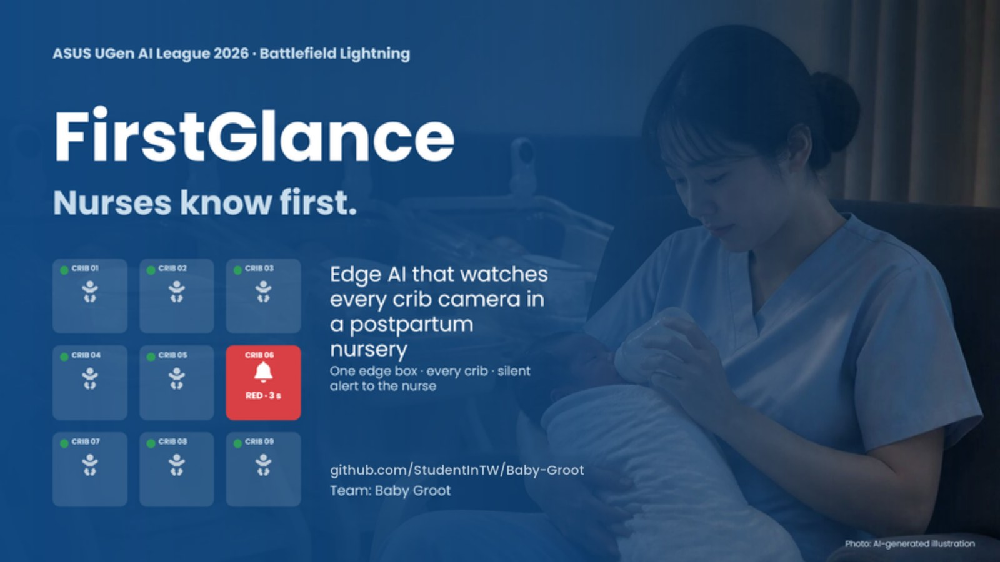
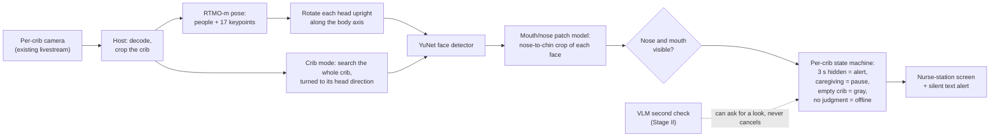

# FirstGlance · per-crib airway watch for postpartum nurseries

**ASUS UGen AI League 2026 · Battlefield Lightning · Team Baby Groot** · 中文技術說明見 [`docs/architecture.md`](./docs/architecture.md)



Many postpartum care centres in Taiwan already film every crib in the nursery from above and stream it to parents.
Nobody watches those streams continuously: on a night shift one carer looks after several newborns. FirstGlance, our edge box
(ASUS UGen300 / Hailo-10H), reads the existing per-crib cameras and, when a baby's nose and mouth stay out of sight for
3 seconds (face-down, or covered by a blanket or swaddle), quietly tells the nurse first.

It is an observation aid, not a medical device. It does not monitor breathing or vital signs and makes no claims about
SIDS; it works alongside safe-sleep practice, not instead of it. The AI judges locally and stores no video.

## Status

| Part | Status |
| --- | --- |
| Per-crib pipeline: pose → face → mouth/nose check → 3-second alert | Runs on a laptop, with the pose model on the UGen300 or on the CPU; evaluated on doll videos, doll photos and real infant photos |
| Mouth/nose patch model (v6, the main pipeline since 2026-11-24) | Trained on one half of our own doll footage only; scored on the other half, on doll footage from a postpartum nursery's own camera and on real infant photos (see Results). During development it runs on the host CPU with ONNX Runtime (one thread, about 19 ms per face), so a retrained model needs no recompiling. **Also compiled for the Hailo-10H and runs on the UGen300** (set `FG_MOUTH_HEF`); the build we use has every layer in 16-bit (`model/mouth_F.hef`), and the demo configuration (`demo.live_view --chip`) runs it on the chip next to RTMO-m. With both on the chip, the 30 held-out doll videos give the CPU's counts except one extra false alert, which comes from RTMO-m. With only this model on the chip, the doll photos give the same counts, and SyRIP's 81 nursery-like photos get 1 more false alert (10 vs 9). Its speed cost depends on how the chip is shared: with each crib's thread sending its own frames it costs nothing measurable, but in the demo configuration (chip in a child process, one frame at a time) the chip is the bottleneck and the total drops from 21.1 frames per second with this model on the CPU to 16.2 with it on the chip (8 cribs, a face in every frame; see Hardware integration). The demo configuration ran 8 hours with 8 cribs without a USB disconnect |
| Caregiving pause, empty-crib gray state | Prototype, tested on five per-crib doll clips from fixed cameras: one of ours (a normal pick-up) and four from two postpartum nurseries' own cameras. Two hand-held clips are left out, because this logic assumes a fixed camera. One known problem: on one nursery camera a danger was shown as an empty crib for 4.4 s |
| VLM second check (Qwen2-VL-2B) | Works as a laptop GPU experiment. Hailo's precompiled HEF also runs on the UGen300 (about 1 s per question, in the same process as the pipeline), but there it calls every side face "not visible", so it is **not usable on the chip yet** (see Hardware integration) |
| Pose model (RTMO-m) on the Hailo-10H | **Runs on the UGen300 inside the pipeline.** Plain 8-bit quantization lost too much accuracy, so we retrained the network to tolerate 8-bit (quantization-aware training). On all three test sets the results match the original float model on the CPU |
| YuNet face model on the Hailo-10H | **Runs on the UGen300 inside the pipeline** (set `FG_YUNET_HEF`). Its scores differ from OpenCV's by about 0.02, so a few faces near the threshold flip (slightly more false alerts than on the CPU). With YuNet on the chip the USB link drops now and then; with one thread it recovers by itself in 1–3 s (see Hardware integration) |
| On-chip speed and power | v6 at 720p on a laptop host (i7-11800H), a face in every frame, stream decoding not included, frames per second for all cribs together: 7.9 with everything on the CPU; 27.4 with RTMO-m on the chip and each crib's thread sending its own frames (3.5×), a wiring that drops off USB (twice within 2 minutes in one run); 16.2 in the demo configuration (chip in a child process, one frame at a time, RTMO-m and the 16-bit mouth/nose build on the chip), where the chip is the bottleneck. At the 5 frames per second per crib we evaluate at that is 1, 5 and 3 cribs; at 1 frame per second 7, 27 and 16. On the doll videos, 1 frame per second per crib gives the same results as 5 in every situation (alarms up to 0.8 s later); 0.5 starts to miss (see below). With 25 cribs, the chip taking up to 4 queued frames per call, and the 25 camera streams decoded on the same laptop in hardware, the total is 24.1 frames per second, just under 1 per crib, with the mouth/nose model on the chip (23.4 with it on the CPU); that batching dropped off USB 5 times in a one-hour test (recovered each time), while one frame at a time has run 34 hours without a drop. Power: the UGen300 does not report it; to be measured with a USB-C meter |
| Real nursery footage | None yet; a silent pilot needs ethics (IRB) approval first |

## How it works



Each step and where it lives in the code:

1. **Find the people.** RTMO-m returns every person's box and 17 keypoints in one pass. Boxes with fewer than 3 visible
   body keypoints are dropped (for example an adult's hand). `pipeline/infant_face_v3.py` (`load_rtmo`, `make_persons`)
2. **Rotate each head upright, then look for a face.** A lying baby's face is often sideways or upside down, so the head
   region is rotated along the hip-to-shoulder axis and enlarged before YuNet runs. YuNet also runs on the whole frame at
   two scales. `pipeline/infant_face_v3.py` (`head_faces`), `pipeline/face_common.py` (`detect_faces`, `assign_faces`)
3. **Crib mode.** A blanket over the body often hides the baby from the pose model while the face is still in view, so the
   crib area itself is also searched, turned to the crib's head direction (set once at installation). A face belongs to a
   crib by position. No face in the crib means nose and mouth are not visible. `pipeline/crib_detect.py` (`slot_faces`, `detect`)
4. **Check the nose and mouth (v6).** Finding a face does not prove the airway is uncovered: with a blanket up to the
   eyes, a swaddle across the mouth, or an ear taken for a face, the face detector still returns a face. So each face
   in the crib is turned upright with YuNet's five landmarks (eyes, nose tip, mouth corners) and a 96×96 crop from the
   nose to the chin goes to a small model, three ResNet18s averaged, that gives the probability that the nose and mouth
   are uncovered. The crib counts as visible only if at least one face scores 0.5 or more (a fixed threshold, never
   tuned on evaluation data). The crop is sized by the eye-to-mouth distance, not the eye distance, so side faces work
   too. `pipeline/infant_face_v6.py` (`mouth_patch`, `MouthModel`); the crib-level rule is `v6_slot` in `pipeline/crib_detect.py`
5. **Per-crib state machine.** `AlertState` raises an alert after 3 s hidden and clears it after 2 s visible; a visible
   face must last 1 s before it resets the timer, so one false face does not restart the count. `CribState` pauses the
   timer while an adult's hand moves at the crib edge, and turns an empty crib gray when it matches the crib's empty
   reference photo. Motion never clears an alert that is already sounding. `Liveness` turns a crib purple ("offline,
   check this crib in person") when no judgment has finished for 2 s or the last one failed, instead of leaving the
   last light (possibly green) on screen; when judgments come back after a gap, motion seen before the gap is
   discarded and the gap counts as hidden, so a covered face turns red at once. `pipeline/crib_state.py`
6. **Second check (Stage II).** A small vision-language model looks at the head end of the crib and answers "Can you see
   the baby's nose and mouth?". It can raise a yellow "please look", or rank red alerts, but never cancel one: its answer
   flips on 20–35% of near-identical frames. `experiments/vlm_spike.py`. It is not in the main pipeline; the mouth/nose
   patch model (step 4) does that job on every frame

**Key design choice:** a face detector (and then the mouth/nose patch model) decides whether the face is visible, not the pose model's keypoint confidence.
Keypoint confidence is trained on "was this point annotated", not "can it be seen": a baby with its face in the sheet
still gets confident nose and eye keypoints. The pose model says where each person and head is; the face detector says
whether the face can be seen.

## Hardware integration

| Runs on | What |
| --- | --- |
| ASUS UGen300 (Hailo-10H, 40 TOPS INT4, 8 GB) over USB-C | In the demo configuration (`demo.live_view --chip`): RTMO-m and the mouth/nose patch model (16-bit build), with YuNet on the host CPU. YuNet also runs on it (`FG_YUNET_HEF`; kept on the CPU because every call pays the USB round trip and the link drops more often); the Qwen2-VL-2B second check also runs on it (experiment, not accurate enough yet) |
| Host CPU (small PC in the nursery) | Stream decode, crib crops, decoding the models' raw outputs (boxes, keypoints, NMS), the mouth/nose patch model by default (ONNX Runtime), per-crib state machines, event log |

- **HEF compilation** ([`hailo/結果.md`](./hailo/結果.md), plan in [`hailo/轉換計畫.md`](./hailo/轉換計畫.md)):
  YuNet compiles to a Hailo-10H HEF (Dataflow Compiler 5.4.0, target `hailo10h`, 3 contexts), with its raw outputs
  decoded on the host by our own numpy decoder (`hailo/yunet_decode.py`, identical to OpenCV's on the same 640×640
  input). The scripts are in `hailo/`:
  `prep_calib.py` records the exact images the pipeline sends to YuNet (whole frame, head crops, crib crops; original,
  grayscale and dimmed), `compile_hef.py` runs parse → optimize → compile, `compare_yunet.py` compares the quantized
  emulator with ONNX. Calibration uses 768 COCO 2017 val images with licenses that allow commercial use (CC BY and
  similar; optimization level 0). On 384 held-out doll inputs (140 faces) the quantized model changes the face count on
  7 inputs, all faces within 0.1 of the score threshold; scores differ by 0.004 median (0.093 max), boxes by 1.1 px
  median. Adding half of our doll footage to the calibration set did not help on the other half, so the doll data stays
  evaluation-only.
  RTMO-m also compiles (17.5 MB HEF, 5 contexts). Its ONNX file includes box decoding, NMS and the keypoint coordinate
  classifier, which produce a dynamic number of people, so we cut it after the last 8 head convolutions: the chip runs
  the network up to those fixed-shape outputs, and the host runs the rest, extracted unchanged from the original ONNX
  (`hailo/rtmo_post.py`; same detections as the full ONNX, within 0.002 px). The float emulator matches ONNX. **Plain
  8-bit quantization is not usable**: the quantized outputs keep only 0.4–6.7 dB SNR and the person count changes on 5
  of 16 test images. The network is sensitive to errors from its first layers on, and the Dataflow Compiler's channel
  equalization does not support SiLU; its own fine-tuning, activation clipping and per-channel weights do not fix it,
  and a full 16-bit build is rejected for this target (only the first layers can be 16-bit). So we trained the network
  to tolerate 8-bit (quantization-aware training, `hailo/qat_rtmo.py`, on an NCHC H200, using only commercially
  licensed COCO images and our own doll photos; the doll half used for evaluation is never trained on). The trained
  network, with every layer in 8-bit, keeps about 10.5 dB SNR after the compiler's real quantization. Its raw outputs
  still differ from the float model (95th-percentile keypoint error 24 px at the 640×640 input), but the pipeline's
  results do not change (next bullet). Variants with the first three layers in 16-bit place keypoints more precisely
  but run at half the speed and did not improve the pipeline, so we use the all-8-bit network. Details, per-layer
  analysis and every run are in `hailo/結果.md`.
  The mouth/nose patch model (three ResNet18s, 33.5 M parameters) compiles too: 23 MB, 4 contexts, every layer 8-bit.
  `experiments/mouth_patch_export.py --hailo` exports a version with the ImageNet normalization moved into the model
  script (the chip takes the 96×96 BGR patch as is) and the three logits as outputs; the host averages them. It is
  calibrated on 1,024 patches from the training half only. On 2,437 held-out patches the quantized model's "mouth and
  nose visible" probability differs from ONNX by 0.012 (median) and 74 patches flip at the 0.5 threshold: 71 of the
  1,473 from the nursery camera, 2 of the 840 from our own held-out footage. Most flips go from visible to not visible,
  so the risk is more false alerts rather than missed dangers. The compiler's own fine-tuning (optimization level 2)
  made it worse (392 flips), so we keep level 0. In the pipeline (first version of the model, 2026-11-24):

  | v6 | Everything on the CPU | Mouth/nose model on the UGen300 | RTMO-m and mouth/nose model on the UGen300 |
  | --- | --- | --- | --- |
  | Doll videos not trained on (30), crib mode: danger caught / safe with a false alert / blind spot alerted | 34/35, 10/40, 10/13 | — | 34/35, 11/40, 10/13 |
  | Doll photos not trained on (110 dolls): hidden alerted / visible with a false alert | 62/68, 4/39 | 62/68, 4/39 | 60/68, 4/39 |
  | SyRIP nursery-like supine, face visible (81): false alerts | 9 | 11 | 10 of 80 |
  | SyRIP all postures, face visible (537): false alerts; hidden (72): alerted | 141, 72/72 | 154, 72/72 | 157 of 540, 74/74 |

  On the videos the only change is one false alert on a side face whose head crop moved with RTMO-m on the chip; every
  segment of the nursery-camera videos matches, because the 3-second rule absorbs the frames that flip. With only the
  mouth/nose model on the chip every doll photo matches the CPU, so the differences in the last column come from
  RTMO-m. On SyRIP the 8-bit model adds a few false alerts and misses no hidden face. Details in `hailo/結果.md`.

  On 2026-11-25 we tried three more builds to close that gap, all calibrated on the training half only and chosen by
  a rule written down first (fewer than half of A's flips in the emulator, then nothing worse than A on the chip in
  the three evaluations). Adding 1,024 augmented calibration patches (downscaled and enlarged again, blurred, lower
  contrast, colour cast, JPEG; build E) doubled the flips to 144, because wider value ranges make the 8-bit steps
  coarser. Sixteen-bit weights and activations in only the first and the last layer of each ResNet18 (G) gave 137
  flips, 118 of them from not visible to visible. With all 63 layers in 16-bit (F: 68.7 MB, 9 contexts) 31 patches
  flip in the emulator and 30 on the chip (A: 74 and 72). In the pipeline with only this model on the chip, F gives
  10 false alerts on SyRIP's 81 nursery-like photos (CPU 9, A 11) and 142 on all 537 face-visible photos (CPU 141,
  A 154), with all 72 hidden faces alerted; the doll photos give the same counts as the CPU and A (62/68 and 4/39;
  two dolls swap), and with RTMO-m on the chip too the 30 doll videos give the same counts as A (34/35, 11/40,
  10/13). **So the chip build we use is F** (`model/mouth_F.hef`). It is roughly four times slower per patch than A
  (15.1 ms against about 4 ms from Python with 16 patches sent together; in the pipeline one crib spends 19 ms per
  frame on it, 8 ms with A and 23–24 ms on the CPU). That does not show in the throughput when each crib's thread
  sends its own frames, but it does in the demo configuration, where the chip takes one frame at a time: 16.2 frames
  per second for 8 cribs against 19.2 with A (speed tables below). The demo configuration runs RTMO-m and this build on the UGen300 (`demo.live_view --chip`); during
  development the model stays on the CPU, where a retrained model runs without recompiling.

  **Second version of the model (2026-11-26).** In side-lying poses YuNet sometimes finds a "face" on the cheek, ear or
  hand with a score between 0.3 and 0.8. The first version was trained only on faces scoring 0.8 or more, so it had
  never seen these. The second version adds them to the training data (a low-score face counts as "mouth and nose
  visible" only in a green frame where it is the single face found), and the split changed at the same time: the five
  videos of a doll in a cot shot on 11/17 moved to evaluation, one hand-held video moved to training, and a new
  side-lying sequence was added for training only. We had planned to lower the crib face threshold to 0.4 with it; that
  candidate failed the rule written down first (one more blind-spot segment missed), so the threshold stays 0.8. With
  0.8 the second version scores about the same as the first on the new evaluation data, and we switched to it so that
  the evaluation never includes videos the model was trained on (we decided this after seeing the results). The chip
  build F was recompiled from it (calibrated on the new training half; 12 of 2,437 held-out patches flip at 0.5, on the
  chip too):

  | v6, second version | Everything on the CPU | RTMO-m and mouth/nose model on the UGen300 |
  | --- | --- | --- |
  | Doll videos not trained on (31 + 3 nursery-camera), crib mode: danger caught / safe with a false alert / blind spot alerted | 43/44, 14/51, 16/17 | 43/44, 16/51, 16/17 |
  | Doll photos not trained on (110 dolls): hidden alerted / visible with a false alert | 62/68, 4/39 | 62/68, 4/39 (mouth/nose model only on the chip) |
  | SyRIP nursery-like supine, face visible (81): false alerts | 7 | 8 (mouth/nose model only on the chip) |
  | SyRIP all postures, face visible (537): false alerts; hidden (72): alerted | 150, 72/72 | 157, 72/72 (mouth/nose model only on the chip) |

  The first version on the same 34 videos: 43/44, 13/51, 14/17. The two extra false alerts on the chip are both on side
  faces in one video from the department-store shoot, the same video where RTMO-m on the chip changed a segment before.
- **On the UGen300** (HailoRT 5.4.0 on Windows over USB, setup in [`hailo/安裝筆記.md`](./hailo/安裝筆記.md)):
  `hailo/hailo_infer.py` wraps HailoRT's Python API, and with `FG_RTMO_HEF` set the pipeline runs RTMO-m's network on
  the chip and its post-processing on the host (`pipeline/infant_face_v3.py`, `load_rtmo`). The chip's outputs match
  the compiler's emulator (keypoints and head positions within 2 px at the 95th percentile). With `FG_YUNET_HEF` set,
  YuNet runs on the chip too: `hailo/yunet_hef.py` is a drop-in for OpenCV's `FaceDetectorYN`. The HEF input is fixed
  at 640×640, so smaller inputs are zero-padded and decoded only inside the real image, and the 1280-px whole-frame
  scale is cut into overlapping 640×640 tiles sent as one batch, merged with a final NMS. Against OpenCV on the same
  inputs (`hailo/compare_yunet_chip.py`, 40 doll photos) scores differ by 0.016–0.027 (median) and boxes by about 1 px.
  The same evaluations as below:

  | Test | Float models on the CPU | RTMO-m on the UGen300 | RTMO-m and YuNet on the UGen300 |
  | --- | --- | --- | --- |
  | Real infant photos (SyRIP, 700; 571 with the face visible, 72 hidden) | 97.7% found, 6.1% false alerts, 98.6% alerted when hidden | 99.0% found, 6.3% false alerts, 98.6% alerted | 99.0%, 7.1%\*, 97.3% |
  | Doll photos (185 dolls), crib mode | Alert recall 90.2%, false alerts 12.2% | 91.7%, 10.2% | 90.2%, 14.3% |
  | Doll videos (6), crib mode, 5 FPS | 29/36 danger segments caught, 8/40 safe segments with a false alert | 30/36, 9/40 | 30/36, 10/40 |

  Moving RTMO-m to the chip changes nothing beyond noise. Moving YuNet too costs a little: the four doll photos that
  flip are all faces scored near the 0.7 threshold (two extra false faces at 0.71 and 0.73, two real faces pushed just
  under it). \*Six alerted SyRIP images are not in our manual relabel list and are counted as false alerts, so 7.1% is
  an upper bound.

- **Speed of the whole pipeline** (`evaluation/bench_multistream.py --threads`, 720p, laptop host with an i7-11800H;
  each crib is a thread sharing the models on the chip, or for the CPU-only column a process of its own; frames from one
  doll video, stream decoding not included):

  | | Everything on the CPU | RTMO-m on the UGen300, YuNet on the CPU | Both on the UGen300 |
  | --- | --- | --- | --- |
  | One crib alone, per frame | 187 ms | 89 ms | 153 ms |
  | All cribs together, frames per second | 8 | 30 (CPU at 99%) | 15 (CPU at 35%) |

  So at 1 frame per second per crib one laptop goes from about 8 cribs to about 30 with the pose model on the chip.
  Moving YuNet to the chip as well halves that: the pipeline calls YuNet 4–5 times per frame on small inputs, and each
  call costs about 14 ms of USB transfer and host-side conversion while the chip itself needs 2.5 ms. It does leave
  most of the CPU free for decoding the camera streams, which the hybrid uses up. Per model (`hailortcli run2`,
  random input): RTMO-m 58 FPS at batch 1 and 95 at batch 8 (17 ms on the chip, 31 ms including USB); YuNet 221 FPS.
  The UGen300 does not report power or current; we will measure power with a USB-C meter.
- **Cost of the mouth/nose patch model (v6).** With everything on the CPU (`bench_multistream --modes full v6`, 720p,
  same frames, one process per crib): one ONNX Runtime call per frame for all faces in the crib, about 8 ms when a face
  is found (ONNX Runtime's default threads) and nothing when none is; one crib alone 175 → 189 ms per frame, 8
  processes together 8.5 → 8.3 frames per second. Compiled for the chip, the model itself takes 3.1 ms per patch (`hailortcli run2`, random input: 274 patches
  per second at batch 1, 1,036 at batch 8); from Python, 16 patches sent together cost 4.0 ms each including USB
  transfer. In the pipeline with RTMO-m on the chip (`bench_multistream --threads --modes full v6`, YuNet on the CPU,
  laptop on AC power, both placements measured back to back):

  | Cribs at once | 1 | 4 | 8 | 16 |
  | --- | --- | --- | --- | --- |
  | Without the mouth/nose model (`full`, two runs), frames per second | 9.3–9.5 | 22.6–22.8 | 26.3–27.8 | 26.6–27.6 |
  | v6, mouth/nose model on the CPU | 8.6 | 16.9 | 19.2 | 19.9 |
  | v6, mouth/nose model on the UGen300 | 9.1 | 22.6 | 27.8 | 28.5 |

  On the CPU the model costs 28% of the throughput with 16 cribs (at 1 frame per second per crib, about 19 cribs
  instead of 27); on the chip it costs nothing measurable. A run earlier the same evening on battery was slower
  throughout but showed the same pattern (16 cribs: 22.5 without the model, 14.5 with it on the CPU, 22.5 on the chip).
  These runs feed frames that are already decoded; decoding the camera streams needs the host CPU as well.

  Most of that CPU cost came from ONNX Runtime's default threading: every call spreads over all cores and competes
  with the other cribs' threads. With the mouth/nose session limited to one thread (`intra_op_num_threads=1`),
  alternating runs gave 28.8–29.0 instead of 22.5–23.2 frames per second with 16 cribs, and one crib was about 3%
  slower. Since 2026-11-25 the pipeline uses one thread for this model (`MOUTH_ORT_THREADS` in
  `pipeline/infant_face_v6.py`). Its outputs are bit-identical to the default on all 4,990 saved patches (batches of
  1 and 4), and re-running the three evaluations on the CPU gave the same results row for row (700 SyRIP photos,
  185 dolls, 30 videos frame by frame). A call for one face takes 18.8 ms instead of 6.4 ms when only one crib runs, about a tenth more time per
  frame for a crib with one face in view. Measured side by side the next morning (alternating runs, laptop on AC
  power; the laptop was faster than the evening before, so compare within this table only):

  | Cribs at once | 1 | 4 | 8 | 16 |
  | --- | --- | --- | --- | --- |
  | Without the mouth/nose model (`full`, four runs), frames per second | 11.1–11.3 | 27.0–27.9 | 31.2–31.7 | 31.0–31.4 |
  | v6, mouth/nose model on the CPU (one thread, two runs) | 10.0–10.3 | 24.4–25.5 | 29.7–30.2 | 29.6 |
  | v6, mouth/nose model on the UGen300 (two runs) | 10.7 | 26.4–26.6 | 31.5 | 31.1–31.3 |

  With one thread the model costs about 5% of the throughput on the CPU and nothing measurable on the chip (at 1
  frame per second per crib, about 29 cribs instead of 31). But those 40 frames have a mouth/nose patch in fewer than
  half of them (0.45 per frame), while a baby lying in a nursery crib shows a face in almost every frame. With 40
  frames that each have exactly one patch (same afternoon, each run compared with a run without the model a minute
  or two apart), the CPU placement ran at 86–92% of that reference with 8–16 cribs and the chip at 97–112%: about a
  tenth slower on the CPU and nothing measurable on the chip, with the cribs as threads of one process.
- **Cribs per laptop with v6** (2026-11-25 evening; the frames with one face each, 720p, i7-11800H on AC power,
  20 s per crib count, two runs of each configuration, stream decoding not included, YuNet on the CPU throughout).
  Three ways to wire it: everything on the CPU with one process per crib (one thread each); the chip shared by the
  crib threads of one process (`--threads`); and the chip in a child process that takes one frame at a time
  (`FG_CHIP_PROCESS=1`, the demo configuration). Frames per second for all cribs together:

  | Configuration | 1 crib | 2 | 4 | 8 | 16 |
  | --- | --- | --- | --- | --- | --- |
  | Everything on the CPU, one process per crib | 1.6 / 1.6 | — | 5.2 / 5.2 | 7.8 / 8.1 | — |
  | One process: RTMO-m on the chip, mouth/nose model on the CPU | 9.2 / 9.2 | — | 23.1 / 23.0 | 27.1 / 27.7 | 26.4 / 27.2 |
  | One process: RTMO-m and mouth/nose F on the chip | 9.2 / 9.2 | — | 24.3 / 24.3 | 28.6 / 23.9\* | 30.1 / 17.5\* |
  | **Child process: RTMO-m and mouth/nose F on the chip (demo)** | 9.0 / 9.1 | 15.3 / 15.3 | 15.8 / 16.1 | 16.2 / 16.3 | — |
  | Child process: RTMO-m and mouth/nose A on the chip | 10.0 / 10.0 | 18.3 / 18.2 | 19.2 / 19.2 | 19.2 / 18.8 | — |
  | Child process: RTMO-m on the chip, mouth/nose model on the CPU | 9.1 / 8.5 | 16.6 / 15.5 | 21.6 / 20.2 | 21.5 / 20.8 | — |

  One crib alone takes 198–203 ms per frame with everything on the CPU (ONNX Runtime's default threads; RTMO-m
  129–135 ms of it) and 102–122 ms with RTMO-m on the chip (RTMO-m 49–52 ms including USB). The 1.6 in the first
  row is one process limited to one thread. With 8 processes the CPU was at 55–59%: one thread each fills about
  the 8 physical cores. An earlier attempt with 16 processes crashed (`WinError 6`), so we stopped at 8.
  \*In the second run of that row the UGen300 dropped off USB twice, during the 8- and the 16-crib measurement
  (reconnected after 4 and 11 s; Windows logged both), so those two numbers include the outage. What this says:
  - **The chip's main contribution is RTMO-m**: from 7.9 frames per second in total to 27.4 (3.5×).
  - **Sharing the chip among crib threads gives the most throughput, but drops off USB** (twice in this 2-minute
    run; 9 times in 3.5 hours on 2026-11-15).
  - **The demo configuration is the stable one, but the chip is its bottleneck**: with F or A on the chip the CPU
    stays at 78–93% and the total stops growing from 4 cribs. There, where the mouth/nose model runs matters: F
    gives 16.2, A 19.2 and the CPU 21.1. The chip does one thing at a time, and the numbers roughly match about
    47 ms of RTMO-m per frame plus 8 ms (A) or 19 ms (F) of mouth/nose model. So "nothing measurable on the chip"
    holds only when crib threads share the chip in one process.
  - In cribs (total divided by frames per second per crib): at the 5 frames per second we evaluate and demo at,
    1 crib on the CPU alone (one crib takes about 200 ms per frame), 5 with RTMO-m on the chip in one process and 3
    in the demo configuration; at 1 frame per second 7, 27 and 16. The child-process rows were measured up to 8
    cribs and the one-process rows up to 16, so the larger counts assume the total stays flat (the demo
    configuration gave 16.3 with 16 cribs once, earlier the same evening). Decoding the camera streams also needs
    the host CPU.
  - **How many frames per second each crib needs** (`evaluation/fps_sweep.py`, `docs/影片測試結果.md` §3m): we
    re-scored the 30 doll videos v6 was not trained on, keeping every k-th of the stored 5 fps per-frame decisions
    (each frame is judged on its own, so this equals running at 5/k fps) and trying every starting frame. At 1
    frame per second or more, every situation matched 5 fps: dangers caught 34/35, yellow-light cases 10/13, false
    alerts on safe segments 9–10 of 38–40 (10/40 at 5 fps); alarms came a median 0.4 s and at most 0.8 s later. At
    0.5 frames per second some starting frames miss 2 yellow-light cases and alarms come up to 2.8 s later. These
    are dolls, mostly lying still; moving babies have not been tested at lower frame rates.
  - **Caregiving pause and empty crib at 1 frame per second** (2026-11-26, `docs/影片測試結果.md` §3h): this logic
    compares consecutive judged frames, so we re-scored it with every starting frame. On the three clips from a
    postpartum nursery's own camera it matched 5 fps: 9/10 dangers caught, 0–3% of clean frames taken for a
    caregiver (1–2% at 5 fps), and the empty-crib spans with a reference photo still ended gray. A clip from another
    nursery's own camera (19 minutes, staff in cleanroom suits placing the doll) also matched: 4/4 dangers, 1–2% of
    clean frames taken for a caregiver (0% at 5 fps). Our two hand-held clips are left out: there the camera moves
    0.8–1.3 px between frames 1 s apart (0.02–0.05 px for fixed cameras), 8–41% of clean frames were taken for a
    caregiver and dangers were missed or late. Measuring the edge motion at 5 fps while judging faces at 1 fps would
    make this robust to a moving camera; it is not done yet.
  - **Known problem in the empty-crib check** (2026-11-26): on that other nursery's camera, a danger segment (a
    blanket over the mouth and nose) was shown as an empty crib for 4.4 s at 5 fps. A white blanket on a white
    mattress differs from the empty-crib photo by only 12.5–18 on our color scale, and the threshold is 14 (set on a
    hand-held clip); the empty crib itself is 0–0.8. The threshold needs to be set again on fixed-camera footage.
  - **25 cribs, batching** (2026-11-25 night; a median center has about 25 baby cribs): still the child-process
    wiring, but the chip process sends up to N queued frames from different cribs in one call (`FG_CHIP_BATCH`;
    N = 1 is the demo's one-at-a-time). Totals with 25 cribs, two runs each, no disconnects in these short runs:

    | Up to N frames per chip call | Mouth/nose model F on the chip (CPU use) | Mouth/nose model on the CPU (CPU use) |
    | --- | --- | --- |
    | 1 (demo) | 15.9 / 16.1 (82–83%) | 21.1 / 21.4 (95%) |
    | 2 | 21.6 / 21.6 (84%) | 26.4 / 26.3 (98%) |
    | 4 | 25.4 / 25.3 (81–83%) | 27.8 / 27.8 (97–98%) |
    | 8 | 25.8 / 24.0 (84–89%) | 26.4 / 24.8 (98–99%) |

    Without stream decoding, batches of 4 reach the 25 frames per second that 25 cribs need at 1 frame per second
    each. The CPU-side mouth/nose model is faster at every batch size (by 25%, 18%, 9% and 3%), but it leaves the
    CPU at 95–99%, while with F on the chip the CPU sits at 80–89%.
  - **25 cribs with stream decoding** (2026-11-26, batches of 4). We made 25 test streams in the per-crib cameras'
    format (1920×1080, 30 frames per second, 3 Mbps H.264, cut from one of our doll videos). The same laptop decoded
    them at their native rate, one process per stream, while it judged the 25 cribs.
    - Decoding alone takes 21% of the CPU with the CPU decoder and 4% with OpenCV's hardware decoder (D3D11). All 25
      streams keep up, with and without judging.
    - With judging on top, the order flips and **F on the chip is faster**, because the CPU-side model leaves no
      room for decoding:

    | Decoding | F on the chip (CPU use) | Mouth/nose model on the CPU (CPU use) |
    | --- | --- | --- |
    | None (table above) | 25.4 / 25.3 (81–83%) | 27.8 / 27.8 (97–98%) |
    | CPU | 19.0 / 18.6 (96%) | 17.2 / 17.2 (99–100%) |
    | Hardware | 23.9 / 24.4 (84–86%) | 23.6 / 23.2 (98%) |

    - So the host should decode in hardware. With F, CPU decoding costs about a quarter of the judging (25.3 → 18.8),
      and hardware decoding about 5% (→ 24.1, about 0.96 frames per second per crib).
    - Not included: receiving RTSP over the network, and converting the judged frame to BGR.
    - Stability: batches of 4 with F and 25 cribs dropped off USB 5 times in a one-hour run (all recovered within
      2 s; see "USB disconnects and recovery" below), against none in 34 hours one frame at a time with 8 cribs.
- **USB disconnects and recovery:** now and then the UGen300 drops off USB and comes back by itself
  (`HAILO_COMMUNICATION_CLOSED`; Windows logs each drop as Kernel-PnP event 1010 for `USB\VID_0B05&PID_1D6F`, and the
  log matches every disconnect our scripts saw). With YuNet on the chip it happens every few minutes with 8 cribs
  (3 times in 5 minutes; once in a 3-minute YuNet-only stress test, `hailo/stress_chip.py`). With RTMO-m alone it shows
  up in long runs (8 cribs, 720p): 9 times in 3.5 hours when 8 crib threads each sent frames to the chip, 5 times in
  8 hours when the cribs' frames went as one batch of up to 4, and none in 18 hours one frame at a time. Lined up by
  the clock, batching dropped as often as separate threads (4 times each between 01:00 and 03:00), while between 03:00
  and 04:30, where the threads dropped 5 times in 1.6 hours, one frame at a time ran 3 hours over two nights without a
  drop. One frame at a time differs in two ways, fewer frames on the chip at once and a less busy chip (22 instead of
  29–30 frames per second), and we cannot tell which matters; the cause is not known (USB power, firmware or driver).
  With the mouth/nose model on the chip as well (same child process, one frame at a time, 8 cribs running v6, laptop
  on AC power the whole time), 8 hours overnight (2026-11-24 23:48 to 07:48) went without a drop: 593,831 frames,
  19.9–20.7 frames per second in every minute, no restart, no error, nothing in the Windows log, and no crib more than
  0.9 s without a judgment. The demo configuration itself (the 16-bit mouth/nose build F instead of the 8-bit A) did
  the same on 2026-11-26 from 01:25 to 09:25: 538,708 frames, a median of 18.7 frames per second, no restart, no
  error, no drop in the Windows log, and no crib more than 0.8 s without a judgment. One frame at a time has now run
  34 hours without a drop (RTMO-m alone 18 hours, with A 8, with F 8), all on one laptop with 8 cribs.
  With one thread,
  `hailo/hailo_infer.py` reconnects and resends within 1–3 s. With several threads, releasing the dead connection can
  deadlock inside pyHailoRT (its completion callbacks need the GIL that `VDevice.release()` holds), and one overnight
  run hung that way. So for several cribs the chip runs in a child process (`hailo/chip_process.py`,
  `FG_CHIP_PROCESS=1`): on any chip error the child exits, the main process starts a new one (about 1.5 s to reopen the
  device and models) and resends the batch, and a child that stops answering is killed after 12 s. By default the
  child takes one frame at a time (21.6 frames per second for 8 cribs, about 2.7 per crib). With `FG_CHIP_BATCH=4` the
  frames queued by several cribs go to the chip together through shared memory: 28.8 frames per second, outputs
  bit-identical to one frame at a time, and in 8 hours with 8 cribs (818,407 frames) all 5 disconnects were recovered
  with no errors and no crib went more than 1.9 s without a judgment. With F on the chip as well and 25 cribs,
  batches of 4 dropped 5 times in one hour (2026-11-26, 103,142 frames, a median of 28.8 frames per second): each
  time the child was back within 2 s with no error, but one crib went 3.6 s without a judgment, past the 2 s offline
  threshold. A child that hangs (simulated by suspending it)
  costs 13.5 s. The live view shows those gaps as a purple "offline" light (`crib_state.Liveness`, 2 s without a
  judgment). Tested on the chip with `demo.live_view --fault hang@86 kill@105`: the hung child turned the crib purple
  2 s after the last judgment and the light came back 11.8 s later; the killed child was back within 2 s, under the
  offline threshold.
- **VLM on the UGen300** (`hailo/vlm_hef.py`): Hailo's GenAI Model Zoo ships Qwen2-VL-2B-Instruct already compiled for
  the Hailo-10H (HEF for HailoRT 5.4.0, 3.26 GB), and pyHailoRT for Windows includes the VLM API. On the chip it loads in
  20 s and answers a yes/no question in 1.03 s (first token; 7 tokens/s after that), as in Hailo's published table.
  Three limits we hit: the input is fixed at 336×336 (our laptop experiment used 448); the API returns text only, so
  the tuned probability threshold cannot be used and the answer is a greedy yes/no; and while it runs pyHailoRT holds
  the GIL, while on Windows over USB a second process cannot open the device, so each question pauses the pipeline in
  the same process for about 1 s. On the two held-out per-crib doll clips it answered "No" to "Can you see the baby's
  nose and mouth?" on 272 of 273 asks when shown the head end of the crib, clear front faces included. Showing it the
  same rotated head crop YuNet sees (`experiments/vlm_spike.py --prep-head`, `--crop head`) fixes front faces, but it
  still calls every side face "not visible": it would catch all 13 frames the detector missed at the cost of asking for
  a look on 26 of 38 safe frames (the laptop version, with its tuned threshold, asks on 9). Next: a wording that counts
  side faces as visible (chosen on other clips), Qwen3-VL-2B (512×288 input, 16-bit activations), or a small trained
  classifier instead. Asking once every 5 s cost about 17% throughput with one crib and nothing measurable with 4–8;
  asking back to back stalls the pipeline completely, so the VLM can only be asked about the cribs in doubt.
- **Why the 10H:** its 8 GB of memory lets a 2B vision-language model sit on the same USB accelerator as the detectors
  (measured: Qwen2-VL-2B loads and runs next to RTMO-m; its accuracy is the open problem, see above).
  USB is enough bandwidth for small crops at 1 frame per second per crib, and it plugs into an ordinary PC.
- **CPU baseline** (`evaluation/bench_multistream.py`, Intel i7-11800H): the full pipeline takes about 170–190 ms per frame,
  so one laptop handles about 8 cribs at 1 FPS. 70–80% of that is the pose model, which is the part we moved to the NPU.
- **Host load from the camera streams:** H.264/H.265 streams must be decoded at full frame rate even if we judge 1 frame
  per second.
  - 25 streams in the per-crib cameras' format (1080p, 30 frames per second, 3 Mbps H.264) take 21% of the laptop's CPU
    with software decoding and 4% with hardware decoding. A 720p, 15 frames per second sub-stream takes 7% with
    software decoding.
  - Software decoding still costs about a quarter of the judging when all 25 cribs are judged as well (see 25 cribs
    with stream decoding above), so the host should decode in hardware.
  - These streams were read from local files. Reading a real recorder over the network cost more: at a daycare center
    on 2026-11-10, 16 main streams from its DVR (1080p, about 11 frames per second each, over Wi-Fi) took 32% of the
    laptop's CPU for decoding alone, 6–7 times as much per frame. That run converted every frame to BGR and did not
    record the codec, so the two are not directly comparable, but the numbers above may be optimistic.

## Results so far

These are proxies: real infant photos taken at home, dolls, and simulations. There is no real nursery data yet.

### Main pipeline (v6) on data it was not trained on

Doll videos use the 3-second rule at 5 frames per second, each labelled segment scored once. The threshold (0.5) was
fixed before any of these runs.

Second version of the mouth/nose model (2026-11-26, see "Second version" above), held-out half after the 11/26 split:

| Test | v3 + crib mode | v4 + crib mode | **v6 + crib mode** |
| --- | --- | --- | --- |
| Doll videos, held-out half (31 videos): danger segments caught / safe segments with a false alert | 34/34, 13/45 | 34/34, 15/45 | 34/34, 14/45 |
| Same 31 videos: nose and mouth uncovered but turned away from the camera, alerted | 11/13 | 11/13 | **12/13** |
| Doll videos recorded on a postpartum nursery's own per-crib camera (3 videos; that doll and camera were never trained on): caught / false alert | 3/10, 0/6 | 8/10, 0/6 | **9/10**, 0/6 |
| Same 3 videos: nose and mouth uncovered but turned away from the camera (the centre wants a reminder), alerted | 1/4 | 1/4 | **4/4** |
| Doll photos, batch 1 (per doll, no crib mode): hidden and alerted / visible with a false alert | 59/68, 2/39 | 62/68, 2/39 | 62/68, **4/39** |
| Real infant photos (SyRIP), nursery-like subset (81 found): false alerts | 5 | 8 | 7 |
| SyRIP, a hand over the mouth and nose (10): alerted | 1 | 1 | **4** |
| SyRIP, nose and mouth hidden (72): alerted | 71 | 71 | 72 |
| SyRIP, every posture, nose and mouth visible (537): false alerts | 6.0% | 10.4% | **27.9%** |

The first version on the same held-out data: 34/34 and 13/45, 11/13; nursery camera 9/10, 0/6, 3/4; SyRIP 9 of 81.

- On the nursery camera v6 adds a swaddle beside the face that covers the mouth (23% of frames judged hidden with v4,
  94% with v6) and two side-lying, slightly face-down segments. Its one miss is a prone segment (96% of frames hidden,
  but not alerting at the segment's last moment; v4 misses it too).
- 24 of the 31 held-out videos show the same doll and crib as training videos, posed again; the five 11/17 videos use
  the same doll model in a different cot. Most remaining false alerts come from the face detector, not the mouth/nose
  model: side faces it does not find at all, or landmarks placed on the cheek. In the training half, 85 of the 153
  safe frames judged hidden had no face in the crib at all, while RTMO-m still placed the nose, eyes and ears in 92% of
  them; that is what we are working on next.
- SyRIP's "nursery-like" subset was fixed image by image before scoring: lying on the back, face visible, no adult hand
  in the picture, one baby alone, and a face large enough (eye-to-mouth ≥ 46 px, about the size on a 1080p per-crib
  camera); pacifiers and toys in the mouth are left out, a hand over the mouth counts as danger. Most of v6's false
  alerts over all 537 images are older babies sitting, crawling or standing with the face turned away, which a
  postpartum nursery does not have; on the nursery-like subset the first version raised one more than v4 (crying with the
  mouth wide open, strong light on the face; the second version raises one fewer). We adopted v6 for the stronger catch rate on doll footage and the nursery camera.

### Earlier results

| Test | Result (v3, the base v6 builds on) |
| --- | --- |
| Real infant photos (SyRIP, 700 images, manually relabelled; internal use only) | 97.7% of infants found (684/700); 6.1% false alerts when the face is visible (35/571); 98.6% alerted when it is hidden (71/72) |
| Doll photos (114 photos, 185 dolls, scored per doll) | Face-down 25/25 alerted; 4.4% false alerts; crib mode lifts alert recall from 62% to 90% |
| Doll videos (6 videos, 3-second rule, crib mode) | 1 FPS per crib: 28/36 danger segments caught (78%), 7/40 safe segments with a false alert; 5 FPS: 29/36 and 8/40. Five segments where the mouth and nose are uncovered but out of the camera's view (side-lying facing away, prone with the head turned) are listed apart and not scored; the system alerted on 3 of them |
| Per-crib doll clips (2 videos, one camera per crib) | 3/7 caught, 0/7 false alerts; misses include an ear taken for a face |
| Caregiving pause and empty crib (prototype) | On our own fixed-camera clip, a normal pick-up (11/08 batch), the light never turns red, where the plain 3-second rule rang for about 49 s (two hand-held clips are left out). On another nursery's own camera (1 clip, v6): 4/4 dangers caught, no false alerts, the empty-crib span ends gray (red for 3 s instead of 50 s), but one danger segment was shown as empty for 4.4 s. On a postpartum nursery's own camera (3 clips, v6): 3 of the 4 empty-crib spans end gray (the fourth has no empty-crib photo), 9/10 dangers caught, no false alerts, and the same at 1 frame per second |
| 11/08 batch: another doll at home, mostly dim (6 per-crib videos, 33 photos; also the classifier's training data) | Videos, 1 FPS: crib mode 4/8 danger segments caught, 1/15 false alerts; with the mouth-skin check (v4) 7/8 and 1/15 (one uncovered side-lying segment out of the camera's view is listed apart). Misses are a cover over the mouth with the eyes showing. Photos: face-down 5/5, but a white collar over the mouth 0/5 even with v4 |
| VLM second check (laptop GPU, 2 unseen clips) | Safe vs dangerous head crops AUC 0.98; found all 13 frames the detector missed, at the cost of 9 extra look requests on safe frames |
| VLM second check on the UGen300 (same 2 clips) | Not usable yet: input fixed at 336×336 and no probabilities. On head crops it still finds all 13 missed frames but would ask for a look on 26 of 38 safe frames (all 21 side faces) |
| Mouth/nose classifier (experiment; trained on one half of our doll footage, scored once on the other half) | Retrained on 11/09 with a new doll batch added (1,208 head crops): hidden airway 186/194 correct, visible 624/892 (AUC 0.951; first version 189/194, 601/892, 0.965). As a second check it flags 61/67 frames the detector missed; on the per-crib clip it asks for 10 extra looks on 228 safe frames. It still calls every side-lying side face of two dolls "not visible" (0/246 in one clip): in the training half those dolls show only frontal faces when the airway is clear, and the new doll's side faces did not carry over to them. On the VLM's 40 test frames: 3/24 extra looks (laptop VLM 5/24, chip VLM 16/24) |
| Simulated night (grayscale, software only) | Real infant false alerts (SyRIP, 571 images with the face visible) rise from 6.1% to 18.3%; not a substitute for real IR footage |

Details, failure cases and the experimental v4/v5 variants: [`docs/architecture.md`](./docs/architecture.md),
[`docs/影片測試結果.md`](./docs/影片測試結果.md), [`docs/娃娃測試結果.md`](./docs/娃娃測試結果.md).

## Quick start

Install [uv](https://docs.astral.sh/uv/), then from the repository root:

```bash
uv sync
uv run python -m pipeline.infant_face_v6 your_photo.jpg   # main pipeline; needs model/mouth_patch_ens3.onnx
uv run python -m pipeline.infant_face_v3 your_photo.jpg   # without the mouth/nose model (works out of the box)
```

`uv sync` installs about 200 MB and no PyTorch. The first run downloads RTMO-m (about 80 MB). The result is saved to
`outputs/your_photo_v6.jpg` (or `_v3.jpg`): red box = nose and mouth not visible (alert), green = visible, yellow =
detected face, orange (v6) = face found but its nose and mouth judged covered, with the model's probability.

The mouth/nose patch model (`model/mouth_patch_ens3.onnx`, 134 MB) is not in the repository, like the other weights;
it is available from the team, and the four `experiments/mouth_patch_*` scripts rebuild it from our doll footage
(see "Mouth/nose patch model" below). Set `FG_MOUTH_ONNX` to use another path. Without it, `eval_video` compares
v3–v5 only, and `demo.live_view` / `experiments.rtsp_check` need `--mode v3_slot`.

Every script runs from the repository root as a module (`python -m folder.script`).

### Evaluation

The datasets are not in the repository (licensing and privacy): our doll photos and videos are available from the team,
SyRIP from its authors. Results are written to `outputs/`.

```bash
uv run python -m evaluation.eval_video               # doll videos: per-crib judgement + 3-second alerts (no names = every labelled video, incl. the 11/08 batch);
                                                     # adds v6 when the patch model is present and prints v6's score on the videos it was not trained on last
uv run python -m evaluation.eval_video --reuse --on 2  # recompute with another alert rule, no new detection
uv run python -m evaluation.crib_context             # caregiving pause + empty crib (run eval_video first)
uv run python -m evaluation.fps_sweep                # v6 at fewer frames per second per crib, from the stored 5 fps decisions (run eval_video first)
uv run python -m evaluation.eval_doll --det-th 0.15 --batch 1,2,3   # doll photos, scored per doll (the 185-doll results above)
uv run python -m evaluation.eval_doll --det-th 0.15 --batch 4       # the 11/08 batch (one care-training doll), reported separately
uv run python -m evaluation.eval_doll --face v6 --det-th 0.15 --batch 1   # v6: batches 2-4 are its training data, so only batch 1 counts
uv run python -m evaluation.eval_syrip --face v6 --models rtmo   # real infant photos (dataset/SyRIP_Posture.zip); also --face v3, v4
uv run python -m evaluation.score_relabel            # SyRIP false alerts with the manual relabels (all 700 images)
uv run python -m evaluation.syrip_nursery v3 v4 v6   # SyRIP nursery-like subset (the subset lists, like the relabels, are not in the repository)
uv run python -m evaluation.bench_multistream        # CPU throughput: how many cribs one host handles (--modes full v6 for the patch model's cost)
```

Add `--gray` and/or `--dim 0.3` to `eval_video`, `eval_doll` or `eval_syrip` to simulate an IR night view; those results go
to separate folders.

Two video experiments for wide-angle daycare cameras, where a crib is only a corner of the picture:
`eval_video --slot-rtmo` runs the pose model on each crib crop instead of the whole frame, and `evaluation.cctv_sim`
turns our doll videos into simulated CCTV footage (face shrunk to the size a wide-angle camera sees, placed in a 1080p frame,
CCTV-like tone and sharpening, H.264 compression; the settings were matched to a field recording of a doll). `cctv_sim` needs
ffmpeg, which `uv run --with imageio-ffmpeg` provides without changing the project environment:

```bash
uv run python -m evaluation.eval_video --slot-rtmo                     # results in outputs/video_eval_slotrtmo/
uv run --with imageio-ffmpeg python -m evaluation.cctv_sim render --preset daycare IMG_8735   # outputs/cctv_sim/daycare/
uv run python -m evaluation.eval_video IMG_8735 --cctv daycare --fps 1    # results in outputs/video_eval_cctv-daycare/
```

### Demo

```bash
uv run python -m demo.live_view IMG_8432 --start 80   # live judgement on a laptop, at the video's own speed (v6; --mode v3_slot without the patch model)
uv run python -m demo.live_view IMG_8432 --start 80 --fault error@90   # test the offline light: 5 s of failed judgments
uv run python -m demo.live_view IMG_8432 --start 80 --chip   # demo configuration: RTMO-m and the mouth/nose model on the UGen300 (needs the HEFs and pyHailoRT, see below)
uv run python -m demo.demo_render IMG_8432 --start 80 --end 112   # single crib: camera + light + reasons
uv run python -m demo.demo_render --grid              # nurse-station mock-up (8 cribs)
uv run python -m demo.export_assets                   # export real lights for the clickable UI
```

The clickable nurse-station prototype is `demo/ui/index.html`: open it in a browser, no server needed. Without exported
data it uses the synthetic sample in `demo/ui/sample/`. The ⚡ button simulates a chip fault (the recorded lights contain
no real one): after 2 s every crib turns purple ("offline") with a banner, after 13.5 s (the 12 s timeout plus about
1.5 s to restart the chip) the lights come back, and anything that changed during the gap shows only then, as it would
in the real system. A red alert raised before the fault stays up through the gap.

### HEF compilation (Hailo Dataflow Compiler)

The Dataflow Compiler runs on Linux only; on Windows we use WSL2 (Ubuntu 24.04). Install notes, including the WSL GPU
setup and disk-space pitfalls, are in [`hailo/安裝筆記.md`](./hailo/安裝筆記.md).

```bash
# 1. In the project environment: calibration and comparison images -> hailo/calib/*.npy
uv run python -m hailo.prep_calib --coco-dir hailo/calib/coco
# 2. In WSL, inside the DFC virtualenv, from a folder without spaces in its path (e.g. ~/work)
python "/mnt/c/<repo>/hailo/compile_hef.py" --model yunet --name yunet_A --calib coco.npy
python "/mnt/c/<repo>/hailo/compare_yunet.py" --har yunet/yunet_A_quantized.har --data doll_hold.npy coco_hold.npy
# Mouth/nose patch model (v6): export the DFC version (see "Mouth/nose patch model" below), then patches -> hailo/calib/
.venv-vlm/Scripts/python -m experiments.mouth_patch_export p_base model/mouth_patch_ens3_hailo.onnx --hailo
uv run python -m hailo.prep_calib --model mouth   # needs the patches saved by experiments.mouth_patch_build
python "/mnt/c/<repo>/hailo/compile_hef.py" --model mouth --name mouth_A --calib mouth_calib.npy   # in WSL
python "/mnt/c/<repo>/hailo/compare_mouth.py" --har mouth/mouth_A_quantized.har --data mouth_hold.npy
# the build we run on the chip: every layer 16-bit (conv1–conv60 and fc1–fc3 are the layer names the DFC gives the three ResNet18s)
python "/mnt/c/<repo>/hailo/compile_hef.py" --model mouth --name mouth_F --calib mouth_calib.npy \
    --extra "quantization_param([$(echo conv{1..60} fc{1..3} | sed 's/ /, /g')], precision_mode=a16_w16)"
python "/mnt/c/<repo>/hailo/compare_mouth.py" --har mouth/mouth_F_quantized.har --data mouth_hold.npy
```

### Running on the UGen300 (HailoRT)

Install HailoRT 5.4.0 for Windows (Hailo Developer Zone) with the pyHailoRT feature, then unplug and re-plug the
UGen300 so HailoRT's service can boot it; details and pitfalls in [`hailo/安裝筆記.md`](./hailo/安裝筆記.md). The HEF
files are not in the repository (like the other weights); they are built with `hailo/compile_hef.py`.

```bash
hailortcli fw-control identify          # should print Firmware Version 5.4.0 and HAILO10H
# pyHailoRT: copy the wheel out of C:\Program Files\HailoRT\python first (`uv sync` removes it; reinstall afterwards)
uv pip install --python .venv hailort-5.4.0-cp312-cp312-win_amd64.whl
uv run python -m hailo.hailo_infer model/rtmo_D1.hef   # quick check on the chip (random input)
FG_RTMO_HEF=model/rtmo_D1.hef uv run python -m evaluation.eval_syrip --models rtmo --face v3   # pipeline with RTMO-m on the chip
FG_RTMO_HEF=model/rtmo_D1.hef FG_YUNET_HEF=model/yunet_A.hef uv run python -m evaluation.eval_video   # both models on the chip
uv run --with onnx python hailo/compare_rtmo.py --hef model/rtmo_D1.hef --data rtmo_doll_hold.npy --out outputs/hailo/onchip
uv run python -m hailo.compare_yunet_chip model/yunet_A.hef       # YuNet on the chip vs OpenCV, same inputs
uv run python -m hailo.mouth_hef model/mouth_F.hef --data mouth_hold.npy   # mouth/nose patch model on the chip vs ONNX
uv run python -m hailo.stress_chip model/rtmo_D1.hef model/yunet_A.hef --sec 180   # USB disconnect stress test
FG_RTMO_HEF=model/rtmo_D1.hef FG_YUNET_HEF=model/yunet_A.hef uv run python -m evaluation.bench_multistream --threads --res 720 --workers 1 2 4 8 16
FG_CHIP_PROCESS=1 FG_RTMO_HEF=model/rtmo_D1.hef uv run python -m evaluation.bench_multistream --threads --res 720 --workers 1 2 4 8 16   # chip in a child process (add FG_CHIP_BATCH=4 to batch the cribs)
# VLM (Qwen2-VL-2B HEF from Hailo's GenAI Model Zoo, see below)
uv run python -m hailo.vlm_hef model/genai/Qwen2-VL-2B-Instruct.hef   # smoke test: load time, input, seconds per question
uv run python -m experiments.vlm_spike IMG_8429 IMG_8432 --chip model/genai/Qwen2-VL-2B-Instruct.hef   # second check on the chip
uv run python -m experiments.vlm_spike IMG_8429 IMG_8432 --prep-head   # save RTMO head crops, then add --crop head to the runs
FG_RTMO_HEF=model/rtmo_D1.hef uv run python -m evaluation.bench_multistream --threads --modes full --res 720 --workers 1 4 8 --vlm model/genai/Qwen2-VL-2B-Instruct.hef --vlm-every 5
```

In PowerShell set the variables first, e.g. `$env:FG_RTMO_HEF = "model/rtmo_D1.hef"; $env:FG_YUNET_HEF = "model/yunet_A.hef"`.
Every evaluation and demo script accepts them, and `FG_MOUTH_HEF` (e.g. `model/mouth_F.hef`) moves v6's mouth/nose
patch model to the chip the same way (`hailo/mouth_hef.py`). `demo.live_view --chip` sets the demo configuration in
one go (`CHIP_FINALS` in `demo/live_view.py`): `FG_CHIP_PROCESS=1`, `FG_RTMO_HEF=model/rtmo_D1.hef` and
`FG_MOUTH_HEF=model/mouth_F.hef`, with YuNet on the CPU. Playing a 904-second recording from a postpartum nursery's
own per-crib camera (dolls only) this way, it judged 4,518 of the 4,520 frames, 5.0 per second, with no offline
light, error or disconnect (2026-11-26); the on-screen time per frame, a 1-second average, stayed between 101 and
146 ms. `bench_multistream --threads` runs the cribs as threads of one
process that share the UGen300 (one VDevice; HailoRT's scheduler takes turns between the two models).
`FG_CHIP_PROCESS=1` moves the chip into a child process that is restarted after a USB disconnect; we use it for
several cribs and for long runs. `FG_CHIP_BATCH=4` also sends the queued frames of several cribs as one batch, which
is a third faster with 8 cribs but drops off USB more often (5 times in one hour with F and 25 cribs; see "USB
disconnects and recovery" above).
Neither changes the results. `--vlm` still opens the chip from the main process, so it cannot be combined with
`FG_CHIP_PROCESS=1`.
The Qwen2-VL HEF is not compiled by us: download it from
[Hailo's GenAI Model Zoo](https://github.com/hailo-ai/hailo_model_zoo_genai/blob/v5.4.0/docs/MODELS.rst) (the v5.4.0
build, matching HailoRT 5.4.0) into `model/genai/`. With `--vlm`, a thread of the same process asks the VLM while the
cribs run (a second process cannot open the USB device on Windows).

### VLM second check (experiment, NVIDIA GPU)

```bash
uv venv .venv-vlm --python 3.12
uv pip install --python .venv-vlm torch torchvision --index-url https://download.pytorch.org/whl/cu126
uv pip install --python .venv-vlm transformers accelerate bitsandbytes opencv-python pillow
.venv-vlm/Scripts/python -m experiments.vlm_spike IMG_8429 IMG_8432   # run eval_video first
.venv-vlm/Scripts/python -m experiments.vlm_spike IMG_8429 IMG_8432 --size 336   # same 336×336 input as the chip
.venv-vlm/Scripts/python -m experiments.vlm_spike IMG_8429 IMG_8432 --crop head   # head crops (run --prep-head in .venv first)
```

### Mouth/nose patch model (v6): training and export (PyTorch in the same `.venv-vlm`)

```bash
uv pip install --python .venv-vlm safetensors onnx
# pretrained weights: model.safetensors from https://huggingface.co/timm/resnet18.a1_in1k into model/pretrained/resnet18.a1_in1k/
uv run python -m experiments.mouth_patch_crops --half calib --exclude-prefix 寶寶2 --suffix _r2 --train-only 20261119 20261126Tainan   # 1. pick the frames, save head crops (cloth texture)
uv run python -m experiments.mouth_patch_crops --half calib --prefix 寶寶2 --suffix _1123 --det-th 0.15
uv run python -m experiments.mouth_patch_build calib_r2 --low                          # 2. rerun the pipeline, save each face's nose-to-chin crop
uv run python -m experiments.mouth_patch_build calib_1123 --low --out calib_1123_r2   #    (--low: also crib faces scoring 0.3-0.8)
.venv-vlm/Scripts/python -m experiments.mouth_patch_train --train calib_r2 calib_1123_r2 --sets calib_r2 calib_1123_r2 --seed 0 --tag p_r2_s0   # 3. also seeds 1 and 2
.venv-vlm/Scripts/python -m experiments.mouth_patch_export p_r2 model/mouth_patch_ens3.onnx               # 4. three models -> one ONNX
.venv-vlm/Scripts/python -m experiments.mouth_patch_export p_r2 model/mouth_patch_ens3_hailo.onnx --hailo # 5. version for the Hailo compiler
```

Training data is our own doll footage only: the calibration half of `hailo/prep_calib.py` (`SPLITS`, split by whole
video and photo batch; 3,928 faces in the second version, 2026-11-26), including two side-sleeping angle sequences labelled
in `labels/train_20261119.csv` and `labels/train_20261126.csv` (training only). Faces the crib search finds with a score
of 0.3–0.8 are included too (`--low`): in covered or turned-away frames they are negatives, and in a visible frame
only when they are the single face found (otherwise they could be an ear or a hand).
Faces in frames where the nose and mouth are visible are positives; faces the detector still finds in covered or
turned-away frames are negatives; a quarter of the positives get a piece of cloth pasted over the nose and mouth and
become negatives. No real infant image, no SyRIP image and nothing from the web is used for training. The held-out half
and the nursery recordings are only scored, and the 0.5 threshold is not tuned on them. An earlier classifier that read
the whole head crop (`experiments/airway_crops.py`, `airway_train.py`) was not adopted.

## Repository layout

```
pipeline/       the per-crib pipeline (the part that runs on the edge box)
  infant_face_v6.py   main pipeline: v3 + mouth/nose patch model (nose-to-chin crop of each face; ONNX Runtime, or the UGen300 with FG_MOUTH_HEF)
  infant_face_v3.py   pose → heads rotated upright → faces: is each baby's face visible (v6 builds on it)
  infant_face_v4.py   for comparison: v3 + mouth-skin check
  infant_face_v5.py   for comparison: v4 + three face levels (ok / warn / alert)
  face_common.py      thresholds, YuNet face search, matching faces to people, drawing
  crib_detect.py      one frame: are the nose and mouth visible in each crib (crib mode; MAIN_MODE = v6_slot)
  crib_state.py       per-crib state machine: 3-second alert, caregiving pause, empty crib, offline
evaluation/     evaluation scripts and their helpers (label loading, simulated night view, simulated CCTV footage)
demo/           demo renderer, live laptop view, clickable nurse-station UI (ui/)
experiments/    earlier versions (v1, v2) and exploratory spikes kept for comparison, including the VLM second check
                (vlm_spike.py), the training scripts of the mouth/nose patch model (mouth_patch_*.py) and the
                earlier head-crop classifier (airway_crops.py, airway_train.py)
hailo/          HEF conversion (calibration, compile, quantization-aware training, emulator and on-chip comparison,
                host-side decoders, HailoRT runner with drop-ins for YuNet and the mouth/nose patch model, VLM runner,
                USB stress test), plan and results
labels/         our annotations: doll photos, crib areas and timelines for the doll videos, one training-only sequence
model/          YuNet face detector (MIT); RTMO-m downloads on first run; the mouth/nose patch model and HEF files are not included
docs/           technical write-up and test reports (Chinese)
```

## Data, privacy and licences

- No real infant images are in this repository. The doll photos and videos are our own. Public datasets (SyRIP) and any
  footage found online are used for internal evaluation only and are never committed.
- The system judges each frame locally and keeps only text events; it makes no new copy of the video and uploads nothing.
- Third-party components and their licences: [`THIRD_PARTY_NOTICES.md`](./THIRD_PARTY_NOTICES.md). The optional
  `yolo` dependency group (Ultralytics, AGPL-3.0) is used only by the early v1/v2 experiments, not by the pipeline.

## Known limitations

- No real newborns or real nursery footage yet; every number above comes from a proxy.
- The mouth/nose patch model is trained on dolls only. Crying with the mouth wide open, strong light on the face and
  side faces of dolls it has not seen are gaps in its training data; on the nursery-like real infant photos it raises
  one more false alert than the skin check (v4), and on older infants who sit, crawl or stand it raises many more.
  Real newborns need an ethics-approved pilot (IRB) first.
- The patch model only judges faces the detector finds. When YuNet misses a side face, the crib still counts as not
  visible (false alert), and v6 cannot undo that.
- The demo configuration runs the patch model's 16-bit build on the Hailo-10H. It gives the CPU's counts on our doll
  data and one more false alert on SyRIP (10 instead of 9 of the 81 nursery-like photos). It ran 8 hours with 8
  cribs without a USB disconnect (as did the 8-bit build), but that is one night on one laptop, not a guarantee. In the demo configuration the chip is the bottleneck (16.2 frames per second for all cribs
  together on our laptop), which is about 3 cribs at the 5 frames per second we evaluate at.
- A baby lying prone with the head turned sideways keeps the mouth visible, so the light stays green.
- Night (IR) footage is only simulated, and grayscale raises false alerts.
- The UGen300 drops off USB now and then (every few minutes with YuNet on the chip under load; a few times a night
  when several cribs' frames are on the chip at once, and 5 times in one hour with batches of 4, F and 25 cribs; none
  in 34 hours one frame at a time), and we do not know why. With the chip in a child process (`FG_CHIP_PROCESS=1`) the pipeline
  recovers by itself in 1–2 s, and gaps over 2 s show as a purple "offline" light. The live view shows that light on
  real judgments; the nurse-station prototype shows it only for a simulated fault. Whether it should also reach the
  nurse's phone is not decided yet.
- Spit-up is not detected; it is a Stage II research item.
- Getting the per-crib streams depends on the livestream vendors; that is part of Stage II.
