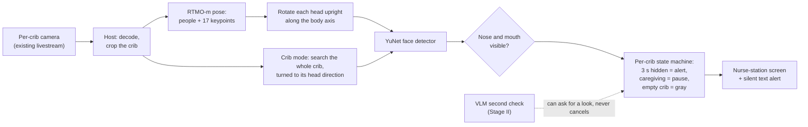

# Baby Groot · per-crib airway watch for postpartum nurseries

**ASUS UGen AI League 2026 · Battlefield Lightning · Team Baby Groot** · 中文技術說明見 [`docs/architecture.md`](./docs/architecture.md)

Many postpartum care centres in Taiwan already film every crib in the nursery from above and stream it to parents.
Nobody watches those streams continuously: on a night shift one carer looks after several newborns. Our edge box
(ASUS UGen300 / Hailo-10H) reads the existing per-crib cameras and, when a baby's nose and mouth stay out of sight for
3 seconds (face-down, or covered by a blanket or swaddle), quietly tells the nurse first.

It is an observation aid, not a medical device. It does not monitor breathing or vital signs and makes no claims about
SIDS; it works alongside safe-sleep practice, not instead of it. The AI judges locally and stores no video.

## Status

| Part | Status |
| --- | --- |
| Per-crib pipeline: pose → face → 3-second alert | Runs on a laptop CPU; evaluated on doll videos, doll photos and real infant photos |
| Caregiving pause, empty-crib gray state | Prototype, tested on two per-crib doll clips |
| VLM second check (Qwen2-VL-2B) | Laptop GPU experiment; moves to the Hailo-10H in Stage II |
| YuNet face model on the Hailo-10H | **Compiled to HEF**; the quantized model matches ONNX in the emulator |
| Pose model (RTMO-m) on the Hailo-10H | Not compiled yet; fallback is YOLOX-m + RTMPose-m |
| On-chip speed and power | Not measured: the UGen300 ships when finalists are announced (2 Nov 2026) |
| Real nursery footage | None yet; a silent pilot needs ethics (IRB) approval first |

## How it works



Each step and where it lives in the code:

1. **Find the people.** RTMO-m returns every person's box and 17 keypoints in one pass. Boxes with fewer than 3 visible
   body keypoints are dropped (for example an adult's hand). `pipeline/infant_face_v3.py` (`load_rtmo`, `make_persons`)
2. **Rotate each head upright, then look for a face.** A lying baby's face is often sideways or upside down, so the head
   region is rotated along the hip-to-shoulder axis and enlarged before YuNet runs. YuNet also runs on the whole frame at
   two scales. `pipeline/infant_face_v3.py` (`head_faces`), `pipeline/face_common.py` (`detect_faces`, `assign_faces`)
3. **Crib mode.** A blanket over the body often hides the baby from the pose model while the face is still in view, so the
   crib area itself is also searched, turned to the crib's head direction (set once at installation). A face belongs to a
   crib by position. No face in the crib means nose and mouth are not visible. `pipeline/crib_detect.py` (`slot_faces`, `detect`)
4. **Per-crib state machine.** `AlertState` raises an alert after 3 s hidden and clears it after 2 s visible; a visible
   face must last 1 s before it resets the timer, so one false face does not restart the count. `CribState` pauses the
   timer while an adult's hand moves at the crib edge, and turns an empty crib gray when it matches the crib's empty
   reference photo. Motion never clears an alert that is already sounding. `pipeline/crib_state.py`
5. **Second check (Stage II).** A small vision-language model looks at the head end of the crib and answers "Can you see
   the baby's nose and mouth?". It can raise a yellow "please look", or rank red alerts, but never cancel one: its answer
   flips on 20–35% of near-identical frames. `experiments/vlm_spike.py`

**Key design choice:** a face detector decides whether the face is visible, not the pose model's keypoint confidence.
Keypoint confidence is trained on "was this point annotated", not "can it be seen": a baby with its face in the sheet
still gets confident nose and eye keypoints. The pose model says where each person and head is; the face detector says
whether the face can be seen.

## Hardware integration

| Runs on | What |
| --- | --- |
| ASUS UGen300 (Hailo-10H, 40 TOPS INT4, 8 GB) over USB-C | RTMO-m (or YOLOX-m + RTMPose-m) and YuNet; in Stage II also the Qwen2-VL-2B second check |
| Host CPU (small PC in the nursery) | Stream decode, crib crops, decoding the models' raw outputs (boxes, keypoints, NMS), per-crib state machines, event log |

- **HEF compilation** ([`hailo/結果.md`](./hailo/結果.md), plan in [`hailo/轉換計畫.md`](./hailo/轉換計畫.md)):
  YuNet compiles to a Hailo-10H HEF (Dataflow Compiler 5.4.0, target `hailo10h`), with its raw outputs decoded on the
  host. Quantized with 256 random COCO 2017 val images. In the emulator the quantized model finds the same faces as ONNX on
  11 test images (19 faces), scores within 0.018, boxes mostly within 0.2–1.2 px. RTMO-m is next and is the riskiest: its
  ONNX file includes decoding with a dynamic number of people, so the end node must be cut before decoding and the decoding
  rewritten for the host.
- **Why the 10H:** its 8 GB of memory lets a 2B vision-language model sit on the same USB accelerator as the detectors.
  USB is enough bandwidth for small crops at 1 frame per second per crib, and it plugs into an ordinary PC.
- **CPU baseline** (`evaluation/bench_multistream.py`, Intel i7-11800H): the full pipeline takes about 170–190 ms per frame,
  so one laptop handles about 8 cribs at 1 FPS. 70–80% of that is the pose model, which is the part that moves to the NPU.
- **Host bottleneck:** H.264/H.265 streams must be decoded at full frame rate even if we judge 1 frame per second, so the host
  should use the cameras' sub-streams or hardware decoding.

## Results so far

These are proxies: real infant photos taken at home, dolls, and simulations. There is no real nursery data yet.

| Test | Result (v3, the baseline) |
| --- | --- |
| Real infant photos (SyRIP, 700 images, manually relabelled; internal use only) | 97.7% of infants found; 6.1% false alerts when the face is visible; 98.6% alerted when it is hidden |
| Doll photos (114 photos, 185 dolls, scored per doll) | Face-down 25/25 alerted; 4.4% false alerts; crib mode lifts alert recall from 62% to 90% |
| Doll videos (6 videos, 3-second rule, crib mode) | 1 FPS per crib: 31/41 danger segments caught (76%), 7/40 safe segments with a false alert; 5 FPS: 32/41 and 8/40 |
| Per-crib doll clips (2 videos, one camera per crib) | 3/7 caught, 0/7 false alerts; misses include an ear taken for a face |
| Caregiving pause and empty crib (prototype) | Both empty-crib spans end gray instead of red; no danger segment judged empty; no new false alerts |
| VLM second check (laptop GPU, 2 unseen clips) | Safe vs dangerous head crops AUC 0.98; found all 13 frames the detector missed, at the cost of 9 extra look requests on safe frames |
| Simulated night (grayscale, software only) | Real infant false alerts rise from 6.1% to 18.3%; not a substitute for real IR footage |

Details, failure cases and the experimental v4/v5 variants: [`docs/architecture.md`](./docs/architecture.md),
[`docs/影片測試結果.md`](./docs/影片測試結果.md), [`docs/娃娃測試結果.md`](./docs/娃娃測試結果.md).

## Quick start

Install [uv](https://docs.astral.sh/uv/), then from the repository root:

```bash
uv sync
uv run python -m pipeline.infant_face_v3 your_photo.jpg
```

`uv sync` installs about 200 MB and no PyTorch. The first run downloads RTMO-m (about 80 MB). The result is saved to
`outputs/your_photo_v3.jpg`: red box = face not visible (alert), green = visible, yellow = detected face.

Every script runs from the repository root as a module (`python -m folder.script`).

### Evaluation

The datasets are not in the repository (licensing and privacy): our doll photos and videos are available from the team,
SyRIP from its authors. Results are written to `outputs/`.

```bash
uv run python -m evaluation.eval_video               # doll videos: per-crib judgement + 3-second alerts
uv run python -m evaluation.eval_video --reuse --on 2  # recompute with another alert rule, no new detection
uv run python -m evaluation.crib_context             # caregiving pause + empty crib (run eval_video first)
uv run python -m evaluation.eval_doll --det-th 0.15  # doll photos, scored per doll
uv run python -m evaluation.eval_syrip --face v3     # real infant photos (dataset/SyRIP_Posture.zip)
uv run python -m evaluation.score_relabel            # SyRIP false alerts with the manual relabels
uv run python -m evaluation.bench_multistream        # CPU throughput: how many cribs one host handles
```

Add `--gray` and/or `--dim 0.3` to `eval_video`, `eval_doll` or `eval_syrip` to simulate an IR night view; those results go
to separate folders.

### Demo

```bash
uv run python -m demo.live_view IMG_8432 --start 80   # live judgement on a laptop, at the video's own speed
uv run python -m demo.demo_render IMG_8432 --start 80 --end 112   # single crib: camera + light + reasons
uv run python -m demo.demo_render --grid              # nurse-station mock-up (8 cribs)
uv run python -m demo.export_assets                   # export real lights for the clickable UI
```

The clickable nurse-station prototype is `demo/ui/index.html`: open it in a browser, no server needed. Without exported
data it uses the synthetic sample in `demo/ui/sample/`.

### VLM second check (experiment, NVIDIA GPU)

```bash
uv venv .venv-vlm --python 3.12
uv pip install --python .venv-vlm torch torchvision --index-url https://download.pytorch.org/whl/cu126
uv pip install --python .venv-vlm transformers accelerate bitsandbytes opencv-python pillow
.venv-vlm/Scripts/python -m experiments.vlm_spike IMG_8429 IMG_8432   # run eval_video first
```

## Repository layout

```
pipeline/       the per-crib pipeline (the part that runs on the edge box)
  infant_face_v3.py   pose → heads rotated upright → faces: is each baby's face visible (baseline)
  infant_face_v4.py   experiment: v3 + mouth-skin check
  infant_face_v5.py   experiment: v4 + three face levels (ok / warn / alert)
  face_common.py      thresholds, YuNet face search, matching faces to people, drawing
  crib_detect.py      one frame: is the face visible in each crib (crib mode)
  crib_state.py       per-crib state machine: 3-second alert, caregiving pause, empty crib
evaluation/     evaluation scripts and their helpers (label loading, simulated night view)
demo/           demo renderer, live laptop view, clickable nurse-station UI (ui/)
experiments/    earlier versions (v1, v2) and exploratory spikes, kept for comparison
hailo/          HEF conversion plan and results
labels/         our annotations: doll photos, crib areas and timelines for the doll videos
model/          YuNet face detector (MIT); other weights download on first run
docs/           technical write-up and test reports (Chinese)
```

## Data, privacy and licences

- No real infant images are in this repository. The doll photos and videos are our own. Public datasets (SyRIP) and any
  footage found online are used for internal evaluation only and are never committed.
- The system judges each frame locally and keeps only text events; it makes no new copy of the video and uploads nothing.
- Third-party components and their licences: [`THIRD_PARTY_NOTICES.md`](./THIRD_PARTY_NOTICES.md). The optional
  `yolo` dependency group (Ultralytics, AGPL-3.0) is used only by the early v1/v2 experiments, not by the pipeline.

## Known limitations

- No real newborns or real nursery footage yet; every number above comes from a proxy.
- When the head turns away, YuNet can take an ear for a face, so a hidden airway stays green. The Stage II VLM check flags
  these frames (13/13 on the doll clips).
- A baby lying prone with the head turned sideways keeps the mouth visible, so the light stays green.
- Night (IR) footage is only simulated, and grayscale raises false alerts.
- Spit-up is not detected; it is a Stage II research item.
- Getting the per-crib streams depends on the livestream vendors; that is part of Stage II.
