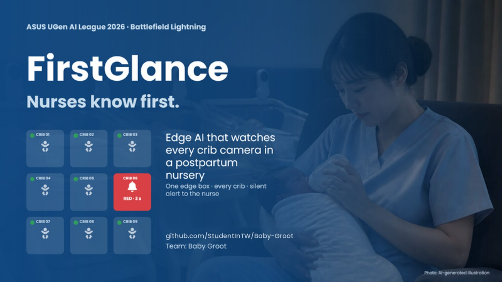
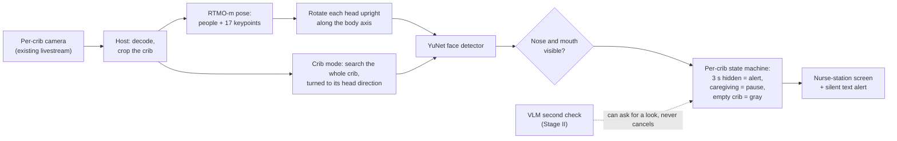

# FirstGlance · per-crib airway watch for postpartum nurseries

**ASUS UGen AI League 2026 · Battlefield Lightning · Team Baby Groot** · 中文技術說明見 [`docs/architecture.md`](./docs/architecture.md)



Many postpartum care centres in Taiwan already film every crib in the nursery from above and stream it to parents.
Nobody watches those streams continuously: on a night shift one carer looks after several newborns. FirstGlance, our edge box
(ASUS UGen300 / Hailo-10H), reads the existing per-crib cameras and, when a baby's nose and mouth stay out of sight for
3 seconds (face-down, or covered by a blanket or swaddle), quietly tells the nurse first.

It is an observation aid, not a medical device. It does not monitor breathing or vital signs and makes no claims about
SIDS; it works alongside safe-sleep practice, not instead of it. The AI judges locally and stores no video.

## Status

| Part | Status |
| --- | --- |
| Per-crib pipeline: pose → face → 3-second alert | Runs on a laptop, with the pose model on the UGen300 or on the CPU; evaluated on doll videos, doll photos and real infant photos |
| Caregiving pause, empty-crib gray state | Prototype, tested on two per-crib doll clips |
| VLM second check (Qwen2-VL-2B) | Works as a laptop GPU experiment. Hailo's precompiled HEF also runs on the UGen300 (about 1 s per question, in the same process as the pipeline), but there it calls every side face "not visible", so it is **not usable on the chip yet** (see Hardware integration) |
| Pose model (RTMO-m) on the Hailo-10H | **Runs on the UGen300 inside the pipeline.** Plain 8-bit quantization lost too much accuracy, so we retrained the network to tolerate 8-bit (quantization-aware training). On all three test sets the results match the original float model on the CPU |
| YuNet face model on the Hailo-10H | **Runs on the UGen300 inside the pipeline** (set `FG_YUNET_HEF`). Its scores differ from OpenCV's by about 0.02, so a few faces near the threshold flip (slightly more false alerts than on the CPU). With YuNet on the chip the USB link drops now and then; with one thread it recovers by itself in 1–3 s (see Hardware integration) |
| On-chip speed and power | Whole pipeline at 720p on a laptop host: about 30 frames per second in total with RTMO-m on the chip and YuNet on the CPU (CPU at 99%), 15 with both on the chip (CPU at 35%), 8 on the CPU alone, i.e. that many cribs at 1 frame per second each (stream decoding not included). Power: the UGen300 does not report it; to be measured with a USB-C meter |
| Real nursery footage | None yet; a silent pilot needs ethics (IRB) approval first |

## How it works



Each step and where it lives in the code:

1. **Find the people.** RTMO-m returns every person's box and 17 keypoints in one pass. Boxes with fewer than 3 visible
   body keypoints are dropped (for example an adult's hand). `pipeline/infant_face_v3.py` (`load_rtmo`, `make_persons`)
2. **Rotate each head upright, then look for a face.** A lying baby's face is often sideways or upside down, so the head
   region is rotated along the hip-to-shoulder axis and enlarged before YuNet runs. YuNet also runs on the whole frame at
   two scales. `pipeline/infant_face_v3.py` (`head_faces`), `pipeline/face_common.py` (`detect_faces`, `assign_faces`)
3. **Crib mode.** A blanket over the body often hides the baby from the pose model while the face is still in view, so the
   crib area itself is also searched, turned to the crib's head direction (set once at installation). A face belongs to a
   crib by position. No face in the crib means nose and mouth are not visible. `pipeline/crib_detect.py` (`slot_faces`, `detect`)
4. **Per-crib state machine.** `AlertState` raises an alert after 3 s hidden and clears it after 2 s visible; a visible
   face must last 1 s before it resets the timer, so one false face does not restart the count. `CribState` pauses the
   timer while an adult's hand moves at the crib edge, and turns an empty crib gray when it matches the crib's empty
   reference photo. Motion never clears an alert that is already sounding. `pipeline/crib_state.py`
5. **Second check (Stage II).** A small vision-language model looks at the head end of the crib and answers "Can you see
   the baby's nose and mouth?". It can raise a yellow "please look", or rank red alerts, but never cancel one: its answer
   flips on 20–35% of near-identical frames. `experiments/vlm_spike.py`. A small classifier trained on our own doll
   footage, reading the same rotated head crop YuNet sees, is the alternative we are testing: `experiments/airway_train.py`

**Key design choice:** a face detector decides whether the face is visible, not the pose model's keypoint confidence.
Keypoint confidence is trained on "was this point annotated", not "can it be seen": a baby with its face in the sheet
still gets confident nose and eye keypoints. The pose model says where each person and head is; the face detector says
whether the face can be seen.

## Hardware integration

| Runs on | What |
| --- | --- |
| ASUS UGen300 (Hailo-10H, 40 TOPS INT4, 8 GB) over USB-C | RTMO-m and YuNet, both running in the pipeline; the Qwen2-VL-2B second check also runs on it (experiment, not accurate enough yet) |
| Host CPU (small PC in the nursery) | Stream decode, crib crops, decoding the models' raw outputs (boxes, keypoints, NMS), per-crib state machines, event log |

- **HEF compilation** ([`hailo/結果.md`](./hailo/結果.md), plan in [`hailo/轉換計畫.md`](./hailo/轉換計畫.md)):
  YuNet compiles to a Hailo-10H HEF (Dataflow Compiler 5.4.0, target `hailo10h`, 3 contexts), with its raw outputs
  decoded on the host by our own numpy decoder (`hailo/yunet_decode.py`, identical to OpenCV's on the same 640×640
  input). The scripts are in `hailo/`:
  `prep_calib.py` records the exact images the pipeline sends to YuNet (whole frame, head crops, crib crops; original,
  grayscale and dimmed), `compile_hef.py` runs parse → optimize → compile, `compare_yunet.py` compares the quantized
  emulator with ONNX. Calibration uses 768 COCO 2017 val images with licenses that allow commercial use (CC BY and
  similar; optimization level 0). On 384 held-out doll inputs (140 faces) the quantized model changes the face count on
  7 inputs, all faces within 0.1 of the score threshold; scores differ by 0.004 median (0.093 max), boxes by 1.1 px
  median. Adding half of our doll footage to the calibration set did not help on the other half, so the doll data stays
  evaluation-only.
  RTMO-m also compiles (17.5 MB HEF, 5 contexts). Its ONNX file includes box decoding, NMS and the keypoint coordinate
  classifier, which produce a dynamic number of people, so we cut it after the last 8 head convolutions: the chip runs
  the network up to those fixed-shape outputs, and the host runs the rest, extracted unchanged from the original ONNX
  (`hailo/rtmo_post.py`; same detections as the full ONNX, within 0.002 px). The float emulator matches ONNX. **Plain
  8-bit quantization is not usable**: the quantized outputs keep only 0.4–6.7 dB SNR and the person count changes on 5
  of 16 test images. The network is sensitive to errors from its first layers on, and the Dataflow Compiler's channel
  equalization does not support SiLU; its own fine-tuning, activation clipping and per-channel weights do not fix it,
  and a full 16-bit build is rejected for this target (only the first layers can be 16-bit). So we trained the network
  to tolerate 8-bit (quantization-aware training, `hailo/qat_rtmo.py`, on an NCHC H200, using only commercially
  licensed COCO images and our own doll photos; the doll half used for evaluation is never trained on). The trained
  network, with every layer in 8-bit, keeps about 10.5 dB SNR after the compiler's real quantization. Its raw outputs
  still differ from the float model (95th-percentile keypoint error 24 px at the 640×640 input), but the pipeline's
  results do not change (next bullet). Variants with the first three layers in 16-bit place keypoints more precisely
  but run at half the speed and did not improve the pipeline, so we use the all-8-bit network. Details, per-layer
  analysis and every run are in `hailo/結果.md`.
- **On the UGen300** (HailoRT 5.4.0 on Windows over USB, setup in [`hailo/安裝筆記.md`](./hailo/安裝筆記.md)):
  `hailo/hailo_infer.py` wraps HailoRT's Python API, and with `FG_RTMO_HEF` set the pipeline runs RTMO-m's network on
  the chip and its post-processing on the host (`pipeline/infant_face_v3.py`, `load_rtmo`). The chip's outputs match
  the compiler's emulator (keypoints and head positions within 2 px at the 95th percentile). With `FG_YUNET_HEF` set,
  YuNet runs on the chip too: `hailo/yunet_hef.py` is a drop-in for OpenCV's `FaceDetectorYN`. The HEF input is fixed
  at 640×640, so smaller inputs are zero-padded and decoded only inside the real image, and the 1280-px whole-frame
  scale is cut into overlapping 640×640 tiles sent as one batch, merged with a final NMS. Against OpenCV on the same
  inputs (`hailo/compare_yunet_chip.py`, 40 doll photos) scores differ by 0.016–0.027 (median) and boxes by about 1 px.
  The same evaluations as below:

  | Test | Float models on the CPU | RTMO-m on the UGen300 | RTMO-m and YuNet on the UGen300 |
  | --- | --- | --- | --- |
  | Real infant photos (SyRIP, 700) | 97.7% found, 6.1% false alerts, 98.6% alerted when hidden | 99.0% found, 6.3% false alerts, 98.6% alerted | 99.0%, 7.1%\*, 97.3% |
  | Doll photos (185 dolls), crib mode | Alert recall 90.2%, false alerts 12.2% | 91.7%, 10.2% | 90.2%, 14.3% |
  | Doll videos (6), crib mode, 5 FPS | 32/41 danger segments caught, 8/40 safe segments with a false alert | 33/41, 9/40 | 33/41, 10/40 |

  Moving RTMO-m to the chip changes nothing beyond noise. Moving YuNet too costs a little: the four doll photos that
  flip are all faces scored near the 0.7 threshold (two extra false faces at 0.71 and 0.73, two real faces pushed just
  under it). \*Six alerted SyRIP images are not in our manual relabel list and are counted as false alerts, so 7.1% is
  an upper bound.

- **Speed of the whole pipeline** (`evaluation/bench_multistream.py --threads`, 720p, laptop host with an i7-11800H;
  each crib is a thread sharing the models on the chip, or for the CPU-only column a process of its own; frames from one
  doll video, stream decoding not included):

  | | Everything on the CPU | RTMO-m on the UGen300, YuNet on the CPU | Both on the UGen300 |
  | --- | --- | --- | --- |
  | One crib alone, per frame | 187 ms | 89 ms | 153 ms |
  | All cribs together, frames per second | 8 | 30 (CPU at 99%) | 15 (CPU at 35%) |

  So at 1 frame per second per crib one laptop goes from about 8 cribs to about 30 with the pose model on the chip.
  Moving YuNet to the chip as well halves that: the pipeline calls YuNet 4–5 times per frame on small inputs, and each
  call costs about 14 ms of USB transfer and host-side conversion while the chip itself needs 2.5 ms. It does leave
  most of the CPU free for decoding the camera streams, which the hybrid uses up. Per model (`hailortcli run2`,
  random input): RTMO-m 58 FPS at batch 1 and 95 at batch 8 (17 ms on the chip, 31 ms including USB); YuNet 221 FPS.
  The UGen300 does not report power or current; we will measure power with a USB-C meter.
- **USB disconnects:** with YuNet on the chip the UGen300 occasionally restarts (`HAILO_COMMUNICATION_CLOSED`) and
  HailoRT's service reloads it: 3 times in a 21-minute video evaluation, once in a 3-minute YuNet-only stress test
  (`hailo/stress_chip.py`) and 3 times in 5 minutes with 8 cribs at once. It never happened with RTMO-m alone on the
  chip (about 45 minutes of evaluation, plus 8 minutes with 8–16 cribs). With one thread, `hailo/hailo_infer.py`
  reconnects and resends the batch within 1–3 s. With several threads sharing the chip, releasing the dead connection
  can deadlock inside pyHailoRT (its completion callbacks need the GIL that `VDevice.release()` holds); waiting for
  the other threads first recovered 2 times out of 3. A reliable fix is to run the chip in a separate process and
  restart that process on a disconnect. The cause of the restarts is not known yet (USB power or firmware). Those
  seconds are not judged, which is what the planned per-crib "offline" state must show.
- **VLM on the UGen300** (`hailo/vlm_hef.py`): Hailo's GenAI Model Zoo ships Qwen2-VL-2B-Instruct already compiled for
  the Hailo-10H (HEF for HailoRT 5.4.0, 3.26 GB), and pyHailoRT for Windows includes the VLM API. On the chip it loads in
  20 s and answers a yes/no question in 1.03 s (first token; 7 tokens/s after that), as in Hailo's published table.
  Three limits we hit: the input is fixed at 336×336 (our laptop experiment used 448); the API returns text only, so
  the tuned probability threshold cannot be used and the answer is a greedy yes/no; and while it runs pyHailoRT holds
  the GIL, while on Windows over USB a second process cannot open the device, so each question pauses the pipeline in
  the same process for about 1 s. On the two held-out per-crib doll clips it answered "No" to "Can you see the baby's
  nose and mouth?" on 272 of 273 asks when shown the head end of the crib, clear front faces included. Showing it the
  same rotated head crop YuNet sees (`experiments/vlm_spike.py --prep-head`, `--crop head`) fixes front faces, but it
  still calls every side face "not visible": it would catch all 13 frames the detector missed at the cost of asking for
  a look on 26 of 38 safe frames (the laptop version, with its tuned threshold, asks on 9). Next: a wording that counts
  side faces as visible (chosen on other clips), Qwen3-VL-2B (512×288 input, 16-bit activations), or a small trained
  classifier instead. Asking once every 5 s cost about 17% throughput with one crib and nothing measurable with 4–8;
  asking back to back stalls the pipeline completely, so the VLM can only be asked about the cribs in doubt.
- **Why the 10H:** its 8 GB of memory lets a 2B vision-language model sit on the same USB accelerator as the detectors
  (measured: Qwen2-VL-2B loads and runs next to RTMO-m; its accuracy is the open problem, see above).
  USB is enough bandwidth for small crops at 1 frame per second per crib, and it plugs into an ordinary PC.
- **CPU baseline** (`evaluation/bench_multistream.py`, Intel i7-11800H): the full pipeline takes about 170–190 ms per frame,
  so one laptop handles about 8 cribs at 1 FPS. 70–80% of that is the pose model, which is the part we moved to the NPU.
- **Host bottleneck:** H.264/H.265 streams must be decoded at full frame rate even if we judge 1 frame per second, so the host
  should use the cameras' sub-streams or hardware decoding.

## Results so far

These are proxies: real infant photos taken at home, dolls, and simulations. There is no real nursery data yet.

| Test | Result (v3, the baseline) |
| --- | --- |
| Real infant photos (SyRIP, 700 images, manually relabelled; internal use only) | 97.7% of infants found; 6.1% false alerts when the face is visible; 98.6% alerted when it is hidden |
| Doll photos (114 photos, 185 dolls, scored per doll) | Face-down 25/25 alerted; 4.4% false alerts; crib mode lifts alert recall from 62% to 90% |
| Doll videos (6 videos, 3-second rule, crib mode) | 1 FPS per crib: 31/41 danger segments caught (76%), 7/40 safe segments with a false alert; 5 FPS: 32/41 and 8/40 |
| Per-crib doll clips (2 videos, one camera per crib) | 3/7 caught, 0/7 false alerts; misses include an ear taken for a face |
| Caregiving pause and empty crib (prototype) | Both empty-crib spans end gray instead of red; no danger segment judged empty; no new false alerts |
| VLM second check (laptop GPU, 2 unseen clips) | Safe vs dangerous head crops AUC 0.98; found all 13 frames the detector missed, at the cost of 9 extra look requests on safe frames |
| VLM second check on the UGen300 (same 2 clips) | Not usable yet: input fixed at 336×336 and no probabilities. On head crops it still finds all 13 missed frames but would ask for a look on 26 of 38 safe frames (all 21 side faces) |
| Mouth/nose classifier (experiment; trained on one half of our doll footage, scored once on the other half) | Hidden airway 189/194 correct, visible 601/892 (AUC 0.965). As a second check it flags 64/67 frames the detector missed; on the per-crib clip it asks for 10 extra looks on 228 safe frames, but it calls every side-lying side face "not visible" (0/246 in one clip), because the training half has too few of them. On the VLM's 40 test frames: 3/24 extra looks (laptop VLM 5/24, chip VLM 16/24) |
| Simulated night (grayscale, software only) | Real infant false alerts rise from 6.1% to 18.3%; not a substitute for real IR footage |

Details, failure cases and the experimental v4/v5 variants: [`docs/architecture.md`](./docs/architecture.md),
[`docs/影片測試結果.md`](./docs/影片測試結果.md), [`docs/娃娃測試結果.md`](./docs/娃娃測試結果.md).

## Quick start

Install [uv](https://docs.astral.sh/uv/), then from the repository root:

```bash
uv sync
uv run python -m pipeline.infant_face_v3 your_photo.jpg
```

`uv sync` installs about 200 MB and no PyTorch. The first run downloads RTMO-m (about 80 MB). The result is saved to
`outputs/your_photo_v3.jpg`: red box = face not visible (alert), green = visible, yellow = detected face.

Every script runs from the repository root as a module (`python -m folder.script`).

### Evaluation

The datasets are not in the repository (licensing and privacy): our doll photos and videos are available from the team,
SyRIP from its authors. Results are written to `outputs/`.

```bash
uv run python -m evaluation.eval_video               # doll videos: per-crib judgement + 3-second alerts
uv run python -m evaluation.eval_video --reuse --on 2  # recompute with another alert rule, no new detection
uv run python -m evaluation.crib_context             # caregiving pause + empty crib (run eval_video first)
uv run python -m evaluation.eval_doll --det-th 0.15  # doll photos, scored per doll
uv run python -m evaluation.eval_doll --det-th 0.15 --batch 4   # only one shooting batch (the labels' batch column)
uv run python -m evaluation.eval_syrip --face v3     # real infant photos (dataset/SyRIP_Posture.zip)
uv run python -m evaluation.score_relabel            # SyRIP false alerts with the manual relabels
uv run python -m evaluation.bench_multistream        # CPU throughput: how many cribs one host handles
```

Add `--gray` and/or `--dim 0.3` to `eval_video`, `eval_doll` or `eval_syrip` to simulate an IR night view; those results go
to separate folders.

### Demo

```bash
uv run python -m demo.live_view IMG_8432 --start 80   # live judgement on a laptop, at the video's own speed
uv run python -m demo.demo_render IMG_8432 --start 80 --end 112   # single crib: camera + light + reasons
uv run python -m demo.demo_render --grid              # nurse-station mock-up (8 cribs)
uv run python -m demo.export_assets                   # export real lights for the clickable UI
```

The clickable nurse-station prototype is `demo/ui/index.html`: open it in a browser, no server needed. Without exported
data it uses the synthetic sample in `demo/ui/sample/`.

### HEF compilation (Hailo Dataflow Compiler)

The Dataflow Compiler runs on Linux only; on Windows we use WSL2 (Ubuntu 24.04). Install notes, including the WSL GPU
setup and disk-space pitfalls, are in [`hailo/安裝筆記.md`](./hailo/安裝筆記.md).

```bash
# 1. In the project environment: calibration and comparison images -> hailo/calib/*.npy
uv run python -m hailo.prep_calib --coco-dir hailo/calib/coco
# 2. In WSL, inside the DFC virtualenv, from a folder without spaces in its path (e.g. ~/work)
python "/mnt/c/<repo>/hailo/compile_hef.py" --model yunet --name yunet_A --calib coco.npy
python "/mnt/c/<repo>/hailo/compare_yunet.py" --har yunet/yunet_A_quantized.har --data doll_hold.npy coco_hold.npy
```

### Running on the UGen300 (HailoRT)

Install HailoRT 5.4.0 for Windows (Hailo Developer Zone) with the pyHailoRT feature, then unplug and re-plug the
UGen300 so HailoRT's service can boot it; details and pitfalls in [`hailo/安裝筆記.md`](./hailo/安裝筆記.md). The HEF
files are not in the repository (like the other weights); they are built with `hailo/compile_hef.py`.

```bash
hailortcli fw-control identify          # should print Firmware Version 5.4.0 and HAILO10H
# pyHailoRT: copy the wheel out of C:\Program Files\HailoRT\python first (`uv sync` removes it; reinstall afterwards)
uv pip install --python .venv hailort-5.4.0-cp312-cp312-win_amd64.whl
uv run python -m hailo.hailo_infer model/rtmo_D1.hef   # quick check on the chip (random input)
FG_RTMO_HEF=model/rtmo_D1.hef uv run python -m evaluation.eval_syrip --models rtmo --face v3   # pipeline with RTMO-m on the chip
FG_RTMO_HEF=model/rtmo_D1.hef FG_YUNET_HEF=model/yunet_A.hef uv run python -m evaluation.eval_video   # both models on the chip
uv run --with onnx python hailo/compare_rtmo.py --hef model/rtmo_D1.hef --data rtmo_doll_hold.npy --out outputs/hailo/onchip
uv run python -m hailo.compare_yunet_chip model/yunet_A.hef       # YuNet on the chip vs OpenCV, same inputs
uv run python -m hailo.stress_chip model/rtmo_D1.hef model/yunet_A.hef --sec 180   # USB disconnect stress test
FG_RTMO_HEF=model/rtmo_D1.hef FG_YUNET_HEF=model/yunet_A.hef uv run python -m evaluation.bench_multistream --threads --res 720 --workers 1 2 4 8 16
# VLM (Qwen2-VL-2B HEF from Hailo's GenAI Model Zoo, see below)
uv run python -m hailo.vlm_hef model/genai/Qwen2-VL-2B-Instruct.hef   # smoke test: load time, input, seconds per question
uv run python -m experiments.vlm_spike IMG_8429 IMG_8432 --chip model/genai/Qwen2-VL-2B-Instruct.hef   # second check on the chip
uv run python -m experiments.vlm_spike IMG_8429 IMG_8432 --prep-head   # save RTMO head crops, then add --crop head to the runs
FG_RTMO_HEF=model/rtmo_D1.hef uv run python -m evaluation.bench_multistream --threads --modes full --res 720 --workers 1 4 8 --vlm model/genai/Qwen2-VL-2B-Instruct.hef --vlm-every 5
```

In PowerShell set the variables first, e.g. `$env:FG_RTMO_HEF = "model/rtmo_D1.hef"; $env:FG_YUNET_HEF = "model/yunet_A.hef"`.
Every evaluation and demo script accepts them. `bench_multistream --threads` runs the cribs as threads of one
process that share the UGen300 (one VDevice; HailoRT's scheduler takes turns between the two models).
The Qwen2-VL HEF is not compiled by us: download it from
[Hailo's GenAI Model Zoo](https://github.com/hailo-ai/hailo_model_zoo_genai/blob/v5.4.0/docs/MODELS.rst) (the v5.4.0
build, matching HailoRT 5.4.0) into `model/genai/`. With `--vlm`, a thread of the same process asks the VLM while the
cribs run (a second process cannot open the USB device on Windows).

### VLM second check (experiment, NVIDIA GPU)

```bash
uv venv .venv-vlm --python 3.12
uv pip install --python .venv-vlm torch torchvision --index-url https://download.pytorch.org/whl/cu126
uv pip install --python .venv-vlm transformers accelerate bitsandbytes opencv-python pillow
.venv-vlm/Scripts/python -m experiments.vlm_spike IMG_8429 IMG_8432   # run eval_video first
.venv-vlm/Scripts/python -m experiments.vlm_spike IMG_8429 IMG_8432 --size 336   # same 336×336 input as the chip
.venv-vlm/Scripts/python -m experiments.vlm_spike IMG_8429 IMG_8432 --crop head   # head crops (run --prep-head in .venv first)
```

### Mouth/nose classifier (experiment, PyTorch in the same `.venv-vlm`)

```bash
uv run python -m experiments.airway_crops              # RTMO head crops from our doll photos and videos (run eval_video first)
.venv-vlm/Scripts/python -m experiments.airway_train   # train on the calibration half, score once on the held-out half
```

Both halves follow `hailo/prep_calib.py` (`SPLITS`, split by whole video and photo batch). Only the first half is ever
used for training; the threshold stays at 0.5 and is not tuned on the held-out half. The first run downloads
torchvision's ImageNet-pretrained ResNet18 weights.

## Repository layout

```
pipeline/       the per-crib pipeline (the part that runs on the edge box)
  infant_face_v3.py   pose → heads rotated upright → faces: is each baby's face visible (baseline)
  infant_face_v4.py   experiment: v3 + mouth-skin check
  infant_face_v5.py   experiment: v4 + three face levels (ok / warn / alert)
  face_common.py      thresholds, YuNet face search, matching faces to people, drawing
  crib_detect.py      one frame: is the face visible in each crib (crib mode)
  crib_state.py       per-crib state machine: 3-second alert, caregiving pause, empty crib
evaluation/     evaluation scripts and their helpers (label loading, simulated night view)
demo/           demo renderer, live laptop view, clickable nurse-station UI (ui/)
experiments/    earlier versions (v1, v2) and exploratory spikes kept for comparison, including the VLM second check
                (vlm_spike.py) and the mouth/nose classifier (airway_crops.py, airway_train.py)
hailo/          HEF conversion (calibration, compile, quantization-aware training, emulator and on-chip comparison,
                host-side decoders, HailoRT runner, VLM runner, USB stress test), plan and results
labels/         our annotations: doll photos, crib areas and timelines for the doll videos
model/          YuNet face detector (MIT); other weights download on first run
docs/           technical write-up and test reports (Chinese)
```

## Data, privacy and licences

- No real infant images are in this repository. The doll photos and videos are our own. Public datasets (SyRIP) and any
  footage found online are used for internal evaluation only and are never committed.
- The system judges each frame locally and keeps only text events; it makes no new copy of the video and uploads nothing.
- Third-party components and their licences: [`THIRD_PARTY_NOTICES.md`](./THIRD_PARTY_NOTICES.md). The optional
  `yolo` dependency group (Ultralytics, AGPL-3.0) is used only by the early v1/v2 experiments, not by the pipeline.

## Known limitations

- No real newborns or real nursery footage yet; every number above comes from a proxy.
- When the head turns away, YuNet can take an ear for a face, so a hidden airway stays green. The VLM check flags
  these frames on the laptop GPU (13/13 on the doll clips), but on the UGen300 it is not accurate enough yet. The
  trained mouth/nose classifier flags 64 of 67 such frames, but until we film more side faces for its training half it
  also flags babies lying on their side with the face visible.
- A baby lying prone with the head turned sideways keeps the mouth visible, so the light stays green.
- Night (IR) footage is only simulated, and grayscale raises false alerts.
- With YuNet on the UGen300 the USB link drops every few minutes under load. Recovery works with one thread but can
  hang with several, and there is no per-crib "offline" state yet to show those gaps.
- Spit-up is not detected; it is a Stage II research item.
- Getting the per-crib streams depends on the livestream vendors; that is part of Stage II.
